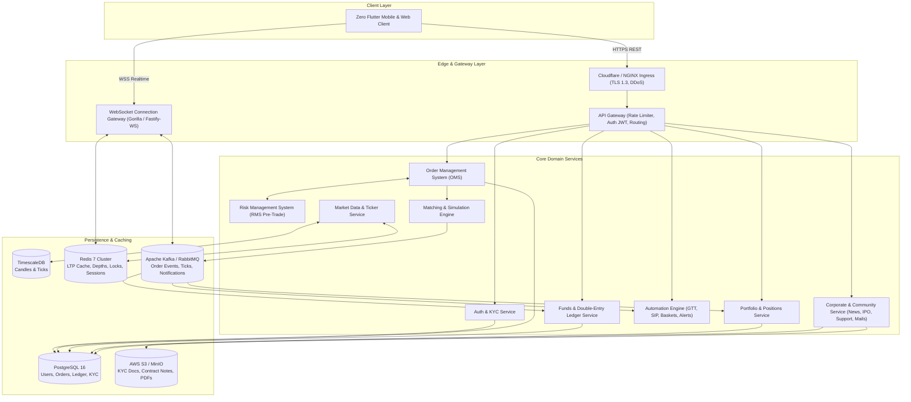
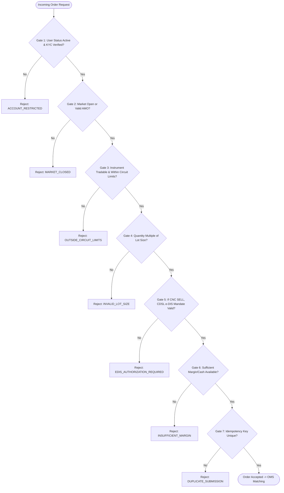
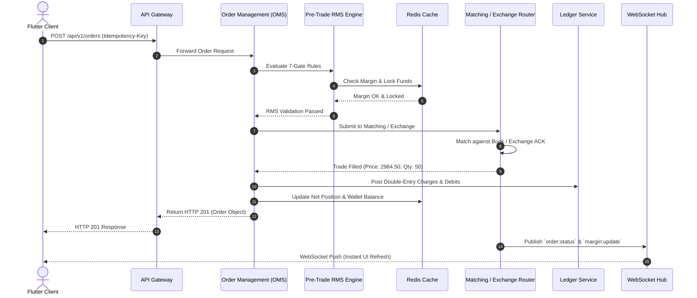
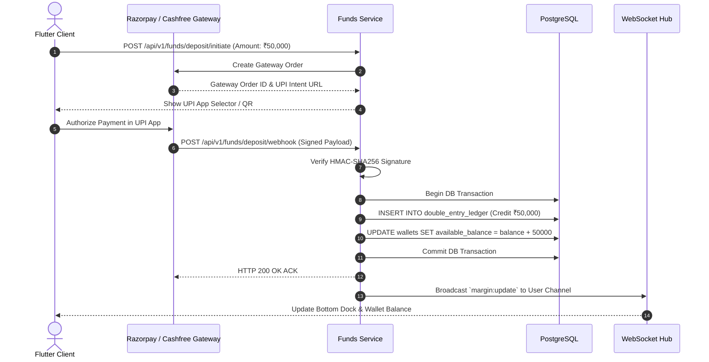

# ZERO TRADING PLATFORM — COMPREHENSIVE BACKEND ARCHITECTURE & IMPLEMENTATION SPECIFICATION
> **Document Status**: Production-Ready Master Specification  
> **Target Systems**: Go (Gin/Fiber) or Node.js (TypeScript/Fastify) Microservices / Modular Monolith  
> **Databases**: PostgreSQL 16 (Relational & Financial Ledger), TimescaleDB (Candles/Ticks), Redis 7 (Cache & Pub/Sub)  
> **Event Broker**: Apache Kafka / RabbitMQ  
> **Storage**: AWS S3 / MinIO (KYC, Contract Notes, Reports, Attachments)  
> **Compliance Standard**: SEBI, PMLA (5-Year Audit Trail), CERT-In (180-Day System Logging)

---

## 1. Executive Summary & System Architecture Overview

The **Zero** trading application requires a high-throughput, low-latency, deterministic, and audited backend architecture. The backend must support real-time WebSocket market feeds, 5-level market depth, sub-millisecond pre-trade Risk Management System (RMS) checks, a double-entry financial accounting ledger, an order matching/simulation engine, background automation daemons (SIP, GTT, Auto Square-Off), and regulatory compliance reporting.

### 1.1 High-Level Architecture Diagram



---

## 2. Folder-by-Folder Frontend-to-Backend Detailed Mapping

This section analyzes **every single directory and file** across `lib/` and specifies the exact backend microservice, database models, API routes, and business rules required to power it.

```
lib/
├── app/                  # App routing, config, provider bootstrap
├── core/
│   ├── constants/        # Charges, regulatory fees, market hours
│   ├── error/            # Failures, exceptions
│   ├── services/         # Real money compliance, edge cases, reconciliation, observability
│   ├── theme/            # Trading color tokens & typography
│   └── utils/            # Formatters, currency, validators
├── data/
│   ├── mock/             # Seed instruments, order engine, ticker simulation
│   └── models/           # 22 entity models (Orders, Funds, Holdings, etc.)
├── features/
│   ├── alerts/           # Price alerts engine
│   ├── auth/             # Login, Register, PIN, TOTP, Forgot Password
│   ├── baskets/          # Multi-leg basket orders
│   ├── calculator/       # Margin & Profit/Loss calculators
│   ├── calendar/         # Economic calendar & corporate announcements
│   ├── charts/           # Fullscreen TradingView-style candlestick engine
│   ├── deals/            # Bulk trades, multi-order cancellation & square-off
│   ├── funds/            # Deposits, withdrawals, ledger, balance breakdown
│   ├── history/          # Ledger audit trail, statement views, transaction details
│   ├── ipo/              # IPO listings, bid applications, UPI mandates
│   ├── net_deals/        # Net aggregated positions & day P&L
│   ├── news/             # Real-time financial news & ticker strip
│   ├── notifications/    # Push notifications, broker mails, preferences
│   ├── option_chain/     # Greeks, strikes, Call/Put OI matrix
│   ├── order_entry/      # Regular, AMO, Bracket, Cover, Iceberg, GTT
│   ├── orders/           # Order book, timeline, charges breakdown, modifications
│   ├── portfolio/        # Equity holdings, performance chart, CDSL e-DIS TPIN
│   ├── positions/        # Day/Net positions, conversion MIS<->CNC, partial exits
│   ├── profile_settings/ # KYC, Nominees, Bank Accounts, Tickets, Live Chat, Reports
│   ├── quote_detail/     # 5-level depth, fundamentals, overview
│   ├── quotes/           # Watchlist groups, drag & drop, quick trade
│   ├── search/           # Full-text instrument search & segment filters
│   ├── sip/              # Systematic Investment Plans
│   └── watchlist/        # Multi-watchlist tab strips & row actions
└── shared_widgets/       # Bottom dock, margin risk banner, market status strip
```

---

### Feature 1: `lib/features/auth/`
**Files**: `auth_controller.dart`, `login_screen.dart`, `register_screen.dart`, `pin_unlock_screen.dart`, `totp_screen.dart`, `forgot_password_sheet.dart`, `splash_screen.dart`

* **Business Purpose**: Multi-factor authentication meeting SEBI 2FA regulatory mandates. Supports User ID/Phone + Password, TOTP (RFC 6238 time-based OTP), quick 4-6 digit MPIN unlock, biometric device binding, and account registration with mobile/email OTP verification.
* **Backend Module**: `AuthService`
* **Database Entities**: `users`, `user_sessions`, `user_credentials`, `user_devices`
* **Endpoints**:
  * `POST /api/v1/auth/register` — Initial registration (Phone, Email, Password, Name).
  * `POST /api/v1/auth/otp/send` — Send OTP via SMS/Email.
  * `POST /api/v1/auth/otp/verify` — Verify phone/email verification code.
  * `POST /api/v1/auth/login` — Step 1: Validate User ID & Password. Returns temporary 2FA token.
  * `POST /api/v1/auth/totp/verify` — Step 2: Validate RFC 6238 TOTP code. Returns access & refresh JWTs.
  * `POST /api/v1/auth/pin/verify` — Verify quick MPIN for returning biometric sessions.
  * `POST /api/v1/auth/pin/set` — Set or update user MPIN.
  * `POST /api/v1/auth/forgot-password/request` & `POST /api/v1/auth/forgot-password/reset` — Account recovery flow.
  * `POST /api/v1/auth/refresh` — Rotate expired access tokens.
  * `POST /api/v1/auth/logout` — Revoke active session tokens in Redis.
* **Backend Rules**:
  * Rate-limit login attempts: 5 failed attempts locks user account for 30 minutes.
  * Store passwords with Argon2id or bcrypt (cost factor 12).
  * Enforce JWT expiry: Access Token = 15 minutes, Refresh Token = 7 days with rotation.

---

### Feature 2: `lib/features/watchlist/` & `lib/features/quotes/`
**Files**: `quotes_screen.dart`, `add_script_screen.dart`, `watchlist_screen.dart`, `watchlist_controller.dart`, `watchlist_tab_strip.dart`, `watchlist_row_actions.dart`

* **Business Purpose**: Allows users to manage multiple watchlist groups (e.g. "Watchlist 1", "Nifty 50", "Options"), reorder items, view live ticker quotes with price change indicators, search and add scripts, and trigger quick buy/sell trade sheets.
* **Backend Module**: `WatchlistService` & `MarketDataService`
* **Database Entities**: `watchlists`, `watchlist_items`, `instruments`
* **Endpoints**:
  * `GET /api/v1/watchlists` — Get all user watchlists with configured order.
  * `POST /api/v1/watchlists` — Create a new watchlist tab.
  * `PUT /api/v1/watchlists/{id}` — Rename watchlist or update display sequence.
  * `DELETE /api/v1/watchlists/{id}` — Delete watchlist.
  * `POST /api/v1/watchlists/{id}/items` — Add instrument token to watchlist.
  * `DELETE /api/v1/watchlists/{id}/items/{token}` — Remove instrument from watchlist.
  * `PUT /api/v1/watchlists/{id}/reorder` — Reorder items within a watchlist.
* **Backend Rules**:
  * Maximum 7 watchlists per user; maximum 50 instruments per watchlist (standard broker limit).
  * Cache watchlist definitions in Redis with 10-minute TTL per user.

---

### Feature 3: `lib/features/quote_detail/` & `lib/features/charts/`
**Files**: `quote_detail_screen.dart`, `depth_tab.dart`, `fundamentals_tab.dart`, `chart_fullscreen_screen.dart`, `chart_view.dart`, `chart_edge_cases.dart`, `indicator_picker_sheet.dart`

* **Business Purpose**: Comprehensive quote view including 5-level bid/ask market depth, fundamental ratios (P/E, P/B, Market Cap, 52W High/Low), and full-screen TradingView-style candlestick charting with multiple timeframes (1m, 3m, 5m, 15m, 30m, 1h, 1D), technical indicators (RSI, MACD, EMA, VWAP, Bollinger Bands), and in-chart quick order execution.
* **Backend Module**: `MarketDataService` & `FundamentalsService`
* **Database Entities**: `candlesticks` (TimescaleDB hypertable), `instruments`, `company_fundamentals`
* **Endpoints**:
  * `GET /api/v1/market/quote/{token}` — Full snapshot: LTP, Open, High, Low, Close, Volume, 52W H/L, circuit limits.
  * `GET /api/v1/market/depth/{token}` — 5-level market depth (Buy orders/qty/price vs Sell orders/qty/price).
  * `GET /api/v1/market/candles/{token}?tf={timeframe}&from={iso}&to={iso}` — Historical OHLCV candle feed.
  * `GET /api/v1/market/fundamentals/{token}` — P/E, P/B, Dividend Yield, Market Cap, Sector P/E, EPS.
* **Realtime Feed (WebSocket)**:
  * Stream live ticks (`LTP`, `Change`, `Volume`) every 100-200ms.
  * Stream 5-level depth snapshot diffs on price level updates.
  * Realtime candle update: Stream current forming candle ticks until interval close.
* **Contract Resolution & Synthetic Fallback Rule**:
  * If a client requests quote or depth details for an exotic, unseeded, or newly listed derivative token, the backend `MarketDataService` must never return an unhandled 404. Instead, it must dynamically synthesize or infer the contract parameters (inferring exchange e.g. MCX, NFO, lot size, and tick size) to ensure depth ladders and charts render seamlessly without dead ends.

---

### Feature 4: `lib/features/search/`
**Files**: `search_screen.dart`, `search_controller.dart`

* **Business Purpose**: Instant full-text fuzzy lookup across all tradable instruments across exchanges (NSE, BSE, NFO, MCX, CDS) and asset classes (Equity, Futures, Call/Put Options, Indices).
* **Backend Module**: `SearchService` (backed by PostgreSQL `pg_trgm` / Elasticsearch / Meilisearch)
* **Database Entities**: `instruments`
* **Endpoints**:
  * `GET /api/v1/instruments/search?q={query}&exchange={NSE,BSE}&segment={EQ,FUT,OPT}&limit=20`
* **Backend Rules**:
  * Sub-20ms response time.
  * Exact symbol prefix match prioritized over company name matches.
  * Support option search shorthand (e.g. "NIFTY 24500 CE", "RELIANCE 3000 PE").

---

### Feature 5: `lib/features/order_entry/`
**Files**: `order_entry_sheet.dart`, `gtt_create_sheet.dart`, `leverage_education_dialog.dart`

* **Business Purpose**: Complex order placement sheet supporting:
  * Product Types: `CNC` (Cash & Carry Equity Delivery), `MIS` (Margin Intraday Square-off), `NRML` (Normal Margin F&O).
  * Varieties: `REGULAR`, `AMO` (After Market Order), `BO` (Bracket Order with target & stop loss), `CO` (Cover Order), `ICEBERG` (Disclosed quantity chunking), `GTT` (Good Till Triggered).
  * Order Kinds: `MARKET`, `LIMIT`, `SL` (Stop Loss Limit), `SL_M` (Stop Loss Market).
  * Validity: `DAY`, `IOC` (Immediate or Cancel).
  * Real-time margin required calculation, margin shortfall warnings, brokerage/statutory charges preview breakdown drawer, and leverage risk education disclosures.
* **Backend Module**: `OrderManagementSystem` (OMS) & `RiskManagementSystem` (RMS)
* **Database Entities**: `orders`, `gtt_rules`, `order_events`, `wallets`
* **Endpoints**:
  * `POST /api/v1/orders/validate-margin` — Pre-order calculation: checks available margin vs required margin and returns full statutory charges breakdown.
  * `POST /api/v1/orders` — Atomically place and execute an order. Requires `Idempotency-Key` header.
  * `POST /api/v1/orders/gtt` — Create GTT rule with trigger price, limit price, and stop loss.
* **Backend Rules**:
  * Enforce pre-trade RMS validation before accepting any order.
  * Block `CNC` sell orders if user does not possess verified CDSL e-DIS holding balance.
  * Enforce statutory price ticks: price must be a valid multiple of `tick_size` (e.g. ₹0.05).
  * Enforce lot size rules: quantity must be a multiple of `lot_size` for derivatives.
  * Enforce AMO market status rules: AMO only accepted during broker defined non-market hours (16:00 to 09:08 IST).

---

### Feature 6: `lib/features/orders/`
**Files**: `orders_screen.dart`, `order_detail_screen.dart`

* **Business Purpose**: Display order lists divided into: Open Orders, Executed Orders, GTT Orders, Baskets, and SIPs. Detailed view shows order lifecycle timeline (`PENDING` -> `OPEN` -> `PARTIALLY_FILLED` -> `COMPLETE`), exchange order ID, rejection reasons, execution price, and action buttons to Modify or Cancel pending orders.
* **Backend Module**: `OrderManagementSystem` (OMS)
* **Database Entities**: `orders`, `order_events`, `trades`
* **Endpoints**:
  * `GET /api/v1/orders/pending` — Fetch currently open and trigger-pending orders.
  * `GET /api/v1/orders/executed` — Fetch filled, cancelled, and rejected orders for the current trading day.
  * `GET /api/v1/orders/{orderId}` — Fetch complete order history including timeline events and execution audit.
  * `PUT /api/v1/orders/{orderId}` — Modify pending order quantity or price.
  * `DELETE /api/v1/orders/{orderId}` — Cancel pending order and release blocked margin.
* **WebSocket Updates**:
  * Push order status change events immediately (`ORDER_ACKNOWLEDGED`, `ORDER_FILLED`, `ORDER_REJECTED`, `ORDER_CANCELLED`) to update UI in real-time.
* **Deep Link & Empty Navigation Stack Fallback**:
  * When users land on `/order-detail/{id}` via push notifications, deep links, or external URLs, if the order is not found (404) or `Navigator.canPop()` is false, the UI must route cleanly back to `/orders` rather than presenting an unresponsive dead-end screen.

---

### Feature 7: `lib/features/positions/`, `lib/features/deals/`, & `lib/features/net_deals/`
**Files**: `positions_screen.dart`, `position_action_sheets.dart`, `deals_screen.dart`, `net_deals_screen.dart`

* **Business Purpose**:
  * Track real-time open positions (Day positions vs Net positions).
  * Calculate live unrealized mark-to-market (MTM) P&L and realized P&L.
  * Position actions: Exit single position, partial exit, convert product type (`MIS` <-> `CNC` / `NRML`), and add stop loss.
  * Bulk operations (Deals): Select multiple positions/orders to perform single-click mass square-off or mass order cancellation.
* **Backend Module**: `PositionService` & `RMSAutoSquareOffService`
* **Database Entities**: `positions`, `position_events`, `orders`
* **Endpoints**:
  * `GET /api/v1/positions/day` — Current day trading positions.
  * `GET /api/v1/positions/net` — Cumulative open positions across segments.
  * `POST /api/v1/positions/{id}/exit` — Exit specific position with market or limit order.
  * `POST /api/v1/positions/{id}/convert` — Convert position (e.g. MIS intraday to CNC delivery after checking required margin).
  * `POST /api/v1/positions/bulk-exit` — Emergency square-off for selected or all open positions.
  * `POST /api/v1/orders/bulk-cancel` — Mass cancel all pending open orders.
* **Backend Rules**:
  * Position conversion requires strict RMS check: converting MIS to CNC requires 100% upfront cash for equities.
  * Scheduled Auto Square-off daemon executes at 15:15 IST for all open MIS positions.

---

### Feature 8: `lib/features/portfolio/`
**Files**: `portfolio_screen.dart`, `portfolio_performance_chart.dart`

* **Business Purpose**: Long-term equity holdings overview: total invested amount, current market valuation, overall P&L, day's P&L, portfolio asset allocation, equity curve performance chart, and CDSL TPIN e-DIS authorization trigger for selling holdings.
* **Backend Module**: `PortfolioService` & `CDSLDepositoryService`
* **Database Entities**: `holdings`, `edis_authorizations`, `corporate_actions`
* **Endpoints**:
  * `GET /api/v1/portfolio/holdings` — List all user demat holdings with average price, quantity, T1 unsettled quantity, and current value.
  * `GET /api/v1/portfolio/summary` — Aggregated portfolio metrics (Total Investment, Current Value, Day P&L, Total P&L).
  * `GET /api/v1/portfolio/performance?range={1M,6M,1Y,ALL}` — Daily equity curve vs Nifty 50 benchmark.
  * `POST /api/v1/portfolio/edis/generate-tpin` — Request CDSL to send TPIN to user's registered mobile.
  * `POST /api/v1/portfolio/edis/verify` — Submit signed e-DIS authorization payload from CDSL gateway to unfreeze delivery shares for trading.
* **Backend Rules**:
  * Follow Indian T+1 rolling settlement: newly bought delivery shares appear under `T1_holdings` until settlement completes.

---

### Feature 9: `lib/features/funds/`
**Files**: `funds_screen.dart`, `add_funds_sheet.dart`, `withdraw_funds_sheet.dart`, `payment_gateway_dialog.dart`, `transaction_receipt_dialog.dart`, `balance_breakdown_dialog.dart`

* **Business Purpose**: Complete wallet and cash management: Available cash margin, collateral margin, used margin, unrealized MTM loss deduction, delivery margin blocked, withdrawal pending balance, instant UPI/Netbanking deposits via payment gateway (Razorpay/Cashfree/PayU), bank withdrawal requests, and transaction receipts.
* **Backend Module**: `FundsService` & `PaymentGatewayService`
* **Database Entities**: `wallets`, `double_entry_ledger`, `payment_transactions`, `withdrawals`, `bank_accounts`
* **Endpoints**:
  * `GET /api/v1/funds/summary?segment={EQUITY,COMMODITY}` — Get detailed balance breakdown.
  * `POST /api/v1/funds/deposit/initiate` — Create payment gateway order (UPI Intent, Netbanking).
  * `POST /api/v1/funds/deposit/webhook` — Asynchronous payment gateway webhook callback (HMAC-SHA256 signature verified).
  * `POST /api/v1/funds/withdraw/initiate` — Request payout to verified user bank account.
  * `GET /api/v1/funds/withdraw/status/{id}` — Track bank withdrawal status.
  * `GET /api/v1/funds/receipt/{txnId}` — Retrieve official payment receipt.
* **Backend Rules**:
  * Double-Entry Accounting: Never run an arbitrary `UPDATE wallets SET balance = balance + X`. Every financial movement must create balanced debit and credit entries in `double_entry_ledger`.
  * Withdrawal limit check: `Withdrawable Amount = Available Cash - Max(0, Intraday MTM Profits until T+1) - Blocked Delivery Margins`.
  * Segregation of client funds: Equity funds and Commodity funds must be kept strictly segregated as per regulatory requirements.

---

### Feature 10: `lib/features/baskets/`
**Files**: `baskets_screen.dart`

* **Business Purpose**: Create multi-leg order baskets (e.g. Bull Call Spread, Iron Condor) to verify combined margin benefits and execute all legs sequentially or concurrently with a single tap.
* **Backend Module**: `BasketService`
* **Database Entities**: `baskets`, `basket_items`
* **Endpoints**:
  * `GET /api/v1/baskets` — List all user baskets.
  * `POST /api/v1/baskets` — Create basket with multiple order legs.
  * `PUT /api/v1/baskets/{id}` — Update basket legs.
  * `DELETE /api/v1/baskets/{id}` — Delete basket.
  * `POST /api/v1/baskets/{id}/margin` — Calculate combined hedged margin requirement.
  * `POST /api/v1/baskets/{id}/execute` — Atomic execution of all legs in the basket. Returns `{ "status": "SUCCESS", "orderIds": ["ord_101", "ord_102"], "executedLegs": 2, "totalMarginUsed": 34500.00 }`.
* **Client Feedback & Navigation Flow**:
  * Upon execution, the mobile client presents an immediate confirmation SnackBar with a direct **"VIEW ORDERS"** CTA routing directly to `/orders` for fill verification.

---

### Feature 11: `lib/features/sip/`
**Files**: `sip_screen.dart`

* **Business Purpose**: Stock SIP (Systematic Investment Plan) scheduler allowing users to invest a fixed amount or quantity in specific stocks or ETFs on a Daily, Weekly, or Monthly recurring basis.
* **Backend Module**: `SipEngineService`
* **Database Entities**: `stock_sips`, `sip_executions`
* **Endpoints**:
  * `GET /api/v1/sip` — List all active and paused SIPs.
  * `POST /api/v1/sip` — Create new stock SIP (Instrument, Amount/Qty, Frequency, Trigger Time). Returns `{ "sipId": "sip_992", "status": "ACTIVE", "nextTriggerDate": "2026-09-09", "message": "SIP created successfully" }`.
  * `PUT /api/v1/sip/{id}/pause` & `PUT /api/v1/sip/{id}/resume` — Toggle SIP state.
  * `DELETE /api/v1/sip/{id}` — Terminate SIP.
  * `GET /api/v1/sip/{id}/history` — View past automated order executions.
* **Backend Rules & Feedback**:
  * Automated cron executes at 09:30 IST on scheduled days, checks wallet balance, and generates automated market orders.
  * Client provides instant SnackBar feedback upon creation and registers the schedule into active state immediately.

---

### Feature 12: `lib/features/alerts/`
**Files**: `alerts_screen.dart`

* **Business Purpose**: Set price alerts on single or multiple instruments based on conditions (`LTP_ABOVE`, `LTP_BELOW`, `PERCENT_CHANGE_UP`, `PERCENT_CHANGE_DOWN`).
* **Backend Module**: `AlertEngineService`
* **Database Entities**: `price_alerts`
* **Endpoints**:
  * `GET /api/v1/alerts` — Fetch user alerts (Active, Triggered, Expired).
  * `POST /api/v1/alerts` — Create price alert.
  * `PUT /api/v1/alerts/{id}` — Modify alert condition/target price.
  * `DELETE /api/v1/alerts/{id}` — Delete alert.
* **Backend Rules**:
  * In-memory Redis stream consumer evaluates price alerts against live ticks in sub-millisecond time.
  * When triggered, dispatches in-app push notification, SMS, and WebSocket alert frame.

---

### Feature 13: `lib/features/ipo/`
**Files**: `ipo_list_screen.dart`

* **Business Purpose**: Browse upcoming, open, and closed IPOs, view price bands, lot sizes, issue dates, and place retail/HNI bids using UPI ID for blocking funds via NPCI UPI Mandate.
* **Backend Module**: `IpoService` & `ExchangeIpoService`
* **Database Entities**: `ipo_listings`, `ipo_applications`
* **Endpoints**:
  * `GET /api/v1/ipo/listings?status={CURRENT,UPCOMING,CLOSED}` — List all IPOs.
  * `GET /api/v1/ipo/listings/{id}` — Issue details, prospectus PDF link, issue size.
  * `POST /api/v1/ipo/apply` — Submit IPO bid with UPI VPA handle and bid lots.
  * `DELETE /api/v1/ipo/cancel/{applicationId}` — Cancel bid before IPO closure.
  * `GET /api/v1/ipo/my-applications` — Track UPI mandate status and allotment results.

---

### Feature 14: `lib/features/option_chain/`
**Files**: `option_chain_screen.dart`

* **Business Purpose**: Complete derivatives matrix for NIFTY, BANKNIFTY, FINNIFTY, and F&O stocks. Displays Strike prices, Call/Put LTP, OI, Change in OI, IV (Implied Volatility), Greeks (Delta, Gamma, Theta, Vega), and Put-Call Ratio (PCR).
* **Backend Module**: `OptionChainService` & `BlackScholesEngine`
* **Endpoints & Routing**:
  * App Route: `/option-chain?symbol={symbol}` accepts either an underlying symbol (e.g. `NIFTY`, `BANKNIFTY`) or instrument token.
  * `GET /api/v1/options/expiries?symbol={symbol}` or `/expiries/{token}` — Get list of active weekly and monthly expiry dates.
  * `GET /api/v1/options/chain?symbol={symbol}&expiry={yyyy-mm-dd}` — Full options chain snapshot with calculated Greeks.
* **Backend Computation**:
  * Black-Scholes pricing model computes Greeks dynamically in Redis cache, refreshed every 5 seconds.

---

### Feature 15: `lib/features/history/`
**Files**: `history_screen.dart`, `statement_view_dialog.dart`, `transaction_detail_sheet.dart`

* **Business Purpose**: Complete regulatory audit trail for the client. View trade history, financial ledger entries, tax P&L summaries, and download digitally signed Contract Note PDFs and CSV statements.
* **UI Streamlining Note**:
  * The Transactions view in `history_screen.dart` presents a clean, friction-free unified chronological ledger stream with immediate search filtering (`q={keyword}`). Redundant double-row filter chips have been removed from the mobile interface to maintain an uncluttered view.
* **Backend Module**: `ReportsAndHistoryService`
* **Database Entities**: `trades`, `double_entry_ledger`, `contract_notes`
* **Endpoints**:
  * `GET /api/v1/history/trades?from={iso}&to={iso}&segment={ALL,EQ,FO}` — Trade execution records.
  * `GET /api/v1/history/ledger?from={iso}&to={iso}&q={keyword}&segment={ALL,EQUITY,COMMODITY}&type={optional}&status={optional}` — Account ledger transactions with running balance. (Supports server-side filtering for web and reports).
  * `GET /api/v1/history/contract-notes` — List daily contract notes.
  * `GET /api/v1/history/contract-notes/{id}/download` — Download digitally signed PDF.
  * `GET /api/v1/history/tax-pnl?financialYear=2025-2026` — Realized capital gains (Short Term vs Long Term).

---

### Feature 16: `lib/features/calendar/`
**Files**: `economic_calendar_screen.dart`

* **Business Purpose**: Displays economic events (RBI MPC rate decisions, CPI Inflation data, GDP releases, Fed decisions) and corporate actions (earnings releases, dividends, bonus shares, splits).
* **Backend Module**: `MarketCalendarService`
* **Database Entities**: `economic_events`, `corporate_calendar`
* **Endpoints**:
  * `GET /api/v1/calendar/economic?from={iso}&to={iso}&country=IN` — Macroeconomic data releases.
  * `GET /api/v1/calendar/corporate?token={optional}&type={EARNINGS,DIVIDEND,SPLIT}` — Corporate earnings and dividends.

---

### Feature 17: `lib/features/calculator/`
**Files**: `margin_calculator_screen.dart`, `profit_calculator_screen.dart`

* **Business Purpose**: Client-side and server-side calculators for exact margin requirement across multi-leg strategies (SPAN + Exposure margin) and net profit calculation after deducting all statutory taxes and brokerage.
* **Backend Module**: `CalculatorEngineService`
* **Endpoints**:
  * `POST /api/v1/calculator/margin` — Compute required SPAN and Exposure margin for complex positions.
  * `POST /api/v1/calculator/brokerage-and-taxes` — Input buy price, sell price, quantity, segment; returns exact net P&L and charges breakdown.

---

### Feature 18: `lib/features/news/`
**Files**: `news_screen.dart`, `news_feed_screen.dart`, `news_ticker_strip.dart`

* **Business Purpose**: Filtered financial news feed, sentiment indicators (Bullish / Neutral / Bearish), news tagged with specific stock tickers, and breaking news updates streamed to the top news ticker strip.
* **Backend Module**: `NewsAggregationService`
* **Database Entities**: `news_articles`, `news_instruments`
* **Endpoints**:
  * `GET /api/v1/news/feed?category={ALL,EQUITIES,MACRO,COMMODITIES}&limit=30` — Paginated news articles.
  * `GET /api/v1/news/instrument/{token}` — News specific to a company.
  * `GET /api/v1/news/ticker` — Top 5 breaking market headlines for live ticker.

---

### Feature 19: `lib/features/notifications/`
**Files**: `notification_center_screen.dart`, `mails_screen.dart`, `notification_preferences_sheet.dart`

* **Business Purpose**: Notification center (Order triggers, margin shortfall alerts, price alerts), official broker email mailbox (contract note dispatch, compliance notices), and user preference switches (Push, SMS, Email, WhatsApp).
* **Backend Module**: `NotificationService` & `BrokerMailService`
* **Database Entities**: `notifications`, `broker_mails`, `user_notification_preferences`
* **Endpoints**:
  * `GET /api/v1/notifications` — Fetch user notifications.
  * `PUT /api/v1/notifications/{id}/read` — Mark notification as read.
  * `GET /api/v1/mails` — Official broker mailbox notices.
  * `GET /api/v1/mails/{id}` — Email body and PDF attachments.
  * `GET /api/v1/notifications/preferences` & `PUT /api/v1/notifications/preferences` — Channel and category notification settings.

---

### Feature 20: `lib/features/profile_settings/`
**Files**: `profile_screen.dart`, `personal_details_sheet.dart`, `kyc_management_sheet.dart`, `nominee_management_sheet.dart`, `settings_screen.dart`, `help_support_screen.dart`, `create_ticket_sheet.dart`, `ticket_detail_screen.dart`, `live_chat_sheet.dart`, `reports_screen.dart`, `about_screen.dart`, `maintenance_screen.dart`

* **Business Purpose**:
  * Account & Profile details: Unique Client Code (UCC), Demat DP ID, activated trading segments (Cash, F&O, Commodity).
  * KYC & Nominees: PAN, Aadhaar CKYC, bank account verification, In-Person Verification (IPV), nominee registration with share allocation.
  * Support & Ticketing: Create ticket with screenshot attachments, view status, exchange messages with support desk, and live support chat.
  * App Settings: Biometric toggles, default order product type, chart preferences, app theme.
  * Maintenance Banner: Real-time checks for scheduled exchange/broker maintenance.
* **Backend Module**: `UserService`, `KycService`, `SupportTicketService`, `MaintenanceService`
* **Database Entities**: `users`, `kyc_verifications`, `nominees`, `bank_accounts`, `support_tickets`, `ticket_messages`, `system_maintenance`
* **Endpoints**:
  * `GET /api/v1/profile` — Full profile, UCC, DP ID, segment statuses.
  * `GET /api/v1/profile/kyc` & `POST /api/v1/profile/kyc/upload` — Manage KYC documents and CKYC status.
  * `GET /api/v1/profile/nominees` & `POST /api/v1/profile/nominees` — Add/Update nominees.
  * `GET /api/v1/profile/bank-accounts` — List verified bank accounts.
  * `GET /api/v1/support/tickets` & `POST /api/v1/support/tickets` — Submit helpdesk tickets.
  * `GET /api/v1/support/tickets/{id}` & `POST /api/v1/support/tickets/{id}/messages` — Ticket conversation thread.
  * `GET /api/v1/system/status` — Returns system maintenance schedule, exchange operational status.
* **Deep Link & Empty Navigation Stack Fallback**:
  * If a user opens `/help/tickets/{id}` directly via deep link or push notification and the ticket is missing (404), the client UI renders a dedicated empty state with a leading navigation fallback routing back to `/help`.

---

### Core Services & Shared Widgets Mapping
* `lib/core/services/market_status_service.dart` & `lib/shared_widgets/market_status_strip.dart`  
  -> Maps to `GET /api/v1/market/status` (Returns open/closed status for NSE, BSE, MCX, pre-open timings, trading holidays).
* `lib/core/services/money_movement_reconciliation_service.dart` & `real_money_compliance_service.dart`  
  -> Maps to backend automated daily reconciliation jobs matching client ledger balance against bank escrow accounts.
* `lib/core/services/edge_case_service.dart` & `observability_service.dart`  
  -> Maps to backend circuit breaker monitoring, exchange link heartbeat monitoring, and Prometheus/Grafana metrics.
* `lib/shared_widgets/zero_bottom_dock.dart` & `lib/shared_widgets/margin_summary_bar.dart`  
  -> Maps to live margin stream on WebSocket (`margin:subscribe`) broadcasting available cash, used margin, and live MTM P&L.
* `lib/shared_widgets/depth_ladder.dart`  
  -> Maps to `depth:subscribe` 5-level market depth real-time WebSocket topic.

---

## 3. Complete Database Schema (PostgreSQL 16 DDL + TimescaleDB)

Below is the complete, syntactically valid relational DDL required to back the entire platform.

```sql
-- Enable necessary extensions
CREATE EXTENSION IF NOT EXISTS "uuid-ossp";
CREATE EXTENSION IF NOT EXISTS "pg_trgm";

-- ============================================================================
-- 1. USERS, AUTHENTICATION & KYC
-- ============================================================================

CREATE TYPE user_status_enum AS ENUM ('PENDING_KYC', 'ACTIVE', 'SUSPENDED', 'BLOCKED');
CREATE TYPE kyc_status_enum AS ENUM ('NOT_STARTED', 'IN_REVIEW', 'VERIFIED', 'REJECTED');
CREATE TYPE gender_enum AS ENUM ('MALE', 'FEMALE', 'OTHER');

CREATE TABLE users (
    id UUID PRIMARY KEY DEFAULT uuid_generate_v4(),
    ucc VARCHAR(20) UNIQUE NOT NULL, -- Unique Client Code (e.g. "ZD109283")
    email VARCHAR(255) UNIQUE NOT NULL,
    phone VARCHAR(20) UNIQUE NOT NULL,
    first_name VARCHAR(100) NOT NULL,
    last_name VARCHAR(100) NOT NULL,
    date_of_birth DATE,
    gender gender_enum,
    pan_number VARCHAR(10) UNIQUE,
    aadhaar_masked VARCHAR(12),
    dp_id VARCHAR(30), -- Depository Participant ID (e.g. CDSL Demat 12081600...)
    status user_status_enum DEFAULT 'PENDING_KYC',
    kyc_status kyc_status_enum DEFAULT 'NOT_STARTED',
    created_at TIMESTAMPTZ NOT NULL DEFAULT NOW(),
    updated_at TIMESTAMPTZ NOT NULL DEFAULT NOW()
);

CREATE TABLE user_credentials (
    user_id UUID PRIMARY KEY REFERENCES users(id) ON DELETE CASCADE,
    password_hash VARCHAR(255) NOT NULL,
    pin_hash VARCHAR(255), -- 4 or 6 digit MPIN
    totp_secret VARCHAR(64), -- Base32 RFC 6238 Secret
    totp_enabled BOOLEAN DEFAULT FALSE,
    biometric_token_hash VARCHAR(255),
    failed_login_attempts INT DEFAULT 0,
    locked_until TIMESTAMPTZ,
    updated_at TIMESTAMPTZ NOT NULL DEFAULT NOW()
);

CREATE TABLE user_sessions (
    id UUID PRIMARY KEY DEFAULT uuid_generate_v4(),
    user_id UUID NOT NULL REFERENCES users(id) ON DELETE CASCADE,
    refresh_token_hash VARCHAR(255) NOT NULL,
    device_id VARCHAR(100) NOT NULL,
    device_name VARCHAR(100),
    ip_address INET NOT NULL, -- Required for CERT-In 180-day logging
    user_agent TEXT,
    expires_at TIMESTAMPTZ NOT NULL,
    created_at TIMESTAMPTZ NOT NULL DEFAULT NOW()
);

CREATE TABLE bank_accounts (
    id UUID PRIMARY KEY DEFAULT uuid_generate_v4(),
    user_id UUID NOT NULL REFERENCES users(id) ON DELETE CASCADE,
    account_number VARCHAR(30) NOT NULL,
    ifsc_code VARCHAR(15) NOT NULL,
    bank_name VARCHAR(100) NOT NULL,
    branch_name VARCHAR(100),
    is_primary BOOLEAN DEFAULT FALSE,
    is_verified BOOLEAN DEFAULT FALSE,
    created_at TIMESTAMPTZ NOT NULL DEFAULT NOW()
);

CREATE TABLE nominees (
    id UUID PRIMARY KEY DEFAULT uuid_generate_v4(),
    user_id UUID NOT NULL REFERENCES users(id) ON DELETE CASCADE,
    name VARCHAR(150) NOT NULL,
    relationship VARCHAR(50) NOT NULL,
    date_of_birth DATE NOT NULL,
    pan_number VARCHAR(10),
    allocation_percentage NUMERIC(5, 2) NOT NULL CHECK (allocation_percentage > 0 AND allocation_percentage <= 100),
    guardian_name VARCHAR(150),
    created_at TIMESTAMPTZ NOT NULL DEFAULT NOW()
);

CREATE TABLE user_settings (
    user_id UUID PRIMARY KEY REFERENCES users(id) ON DELETE CASCADE,
    default_product_type VARCHAR(10) DEFAULT 'CNC',
    default_order_variety VARCHAR(10) DEFAULT 'REGULAR',
    biometric_enabled BOOLEAN DEFAULT FALSE,
    privacy_mode_enabled BOOLEAN DEFAULT FALSE, -- Mask balances
    push_notifications BOOLEAN DEFAULT TRUE,
    sms_alerts BOOLEAN DEFAULT TRUE,
    email_alerts BOOLEAN DEFAULT TRUE,
    updated_at TIMESTAMPTZ NOT NULL DEFAULT NOW()
);

-- ============================================================================
-- 2. INSTRUMENTS & WATCHLISTS
-- ============================================================================

CREATE TYPE exchange_enum AS ENUM ('NSE', 'BSE', 'NFO', 'MCX', 'CDS');
CREATE TYPE instrument_type_enum AS ENUM ('EQ', 'FUT', 'CE', 'PE', 'INDEX');

CREATE TABLE instruments (
    token VARCHAR(50) PRIMARY KEY, -- e.g. "NSE_RELIANCE"
    symbol VARCHAR(50) NOT NULL, -- e.g. "RELIANCE"
    name VARCHAR(200) NOT NULL, -- e.g. "Reliance Industries Ltd"
    exchange exchange_enum NOT NULL,
    type instrument_type_enum NOT NULL,
    lot_size INT NOT NULL DEFAULT 1,
    tick_size NUMERIC(10, 4) NOT NULL DEFAULT 0.05,
    expiry_date DATE,
    strike_price NUMERIC(14, 2),
    isin VARCHAR(20),
    circuit_lower NUMERIC(14, 2),
    circuit_upper NUMERIC(14, 2),
    is_tradable BOOLEAN DEFAULT TRUE,
    created_at TIMESTAMPTZ NOT NULL DEFAULT NOW()
);

CREATE INDEX idx_instruments_search ON instruments USING GIN (symbol gin_trgm_ops, name gin_trgm_ops);
CREATE INDEX idx_instruments_exchange_type ON instruments(exchange, type);

CREATE TABLE watchlists (
    id UUID PRIMARY KEY DEFAULT uuid_generate_v4(),
    user_id UUID NOT NULL REFERENCES users(id) ON DELETE CASCADE,
    name VARCHAR(50) NOT NULL,
    display_order INT NOT NULL DEFAULT 0,
    created_at TIMESTAMPTZ NOT NULL DEFAULT NOW(),
    UNIQUE (user_id, name)
);

CREATE TABLE watchlist_items (
    id UUID PRIMARY KEY DEFAULT uuid_generate_v4(),
    watchlist_id UUID NOT NULL REFERENCES watchlists(id) ON DELETE CASCADE,
    instrument_token VARCHAR(50) NOT NULL REFERENCES instruments(token) ON DELETE CASCADE,
    display_order INT NOT NULL DEFAULT 0,
    created_at TIMESTAMPTZ NOT NULL DEFAULT NOW(),
    UNIQUE (watchlist_id, instrument_token)
);

-- ============================================================================
-- 2.1 CANONICAL SEED INSTRUMENT MASTER CATALOG & ALIAS RESOLUTION
-- ============================================================================

-- Below is the standard seed catalog mirroring lib/data/mock/seed_instruments.dart.
-- Backend developers must populate these records on migration:

INSERT INTO instruments (token, symbol, name, exchange, type, lot_size, tick_size, circuit_lower, circuit_upper, is_tradable) VALUES
-- MCX Commodities
('mcx_gold', 'GOLD Oct', 'Gold Futures 1kg', 'MCX', 'FUT', 100, 1.0000, 68000.00, 75000.00, TRUE),
('mcx_silver', 'SILVER Dec', 'Silver 30kg Futures', 'MCX', 'FUT', 30, 1.0000, 80000.00, 92000.00, TRUE),
('mcx_crude', 'CRUDEOIL Oct', 'Crude Oil 100 BBL', 'MCX', 'FUT', 100, 1.0000, 5800.00, 6800.00, TRUE),
('mcx_natgas', 'NATURALGAS Sep', 'Natural Gas Futures', 'MCX', 'FUT', 1250, 0.1000, 170.00, 230.00, TRUE),
('mcx_copper', 'COPPER Sep', 'Copper Futures', 'MCX', 'FUT', 2500, 0.0500, 780.00, 850.00, TRUE),
('mcx_zinc', 'ZINC Sep', 'Zinc Futures', 'MCX', 'FUT', 5000, 0.0500, 250.00, 290.00, TRUE),

-- Domestic Indices
('idx_nifty50', 'NIFTY 50', 'NIFTY 50 Benchmark Index', 'NSE', 'INDEX', 1, 0.0500, NULL, NULL, TRUE),
('idx_banknifty', 'NIFTY BANK', 'NIFTY Bank Sector Index', 'NSE', 'INDEX', 1, 0.0500, NULL, NULL, TRUE),
('idx_finnifty', 'NIFTY FIN SERVICE', 'NIFTY Financial Services Index', 'NSE', 'INDEX', 1, 0.0500, NULL, NULL, TRUE),
('idx_midcpnifty', 'NIFTY MID SELECT', 'NIFTY Midcap Select Index', 'NSE', 'INDEX', 1, 0.0500, NULL, NULL, TRUE),
('idx_sensex', 'BSE SENSEX', 'BSE Sensitive Index', 'BSE', 'INDEX', 1, 0.0500, NULL, NULL, TRUE),
('idx_bankex', 'BSE BANKEX', 'BSE Bankex Index', 'BSE', 'INDEX', 1, 0.0500, NULL, NULL, TRUE),

-- Global Indices
('global_us500', 'US 500 (S&P 500)', 'S&P 500 Global Benchmark Index', 'NSE', 'INDEX', 1, 0.1000, NULL, NULL, TRUE),
('global_nasdaq', 'US Tech 100 (NASDAQ)', 'NASDAQ 100 Global Index', 'NSE', 'INDEX', 1, 0.1000, NULL, NULL, TRUE),
('global_dow', 'US Wall St 30 (DOW)', 'Dow Jones Industrial Average', 'NSE', 'INDEX', 1, 0.1000, NULL, NULL, TRUE),

-- Forex & Spot Metals
('cds_usdinr', 'USDINR Sep', 'US Dollar / Indian Rupee', 'CDS', 'FUT', 1000, 0.0025, 83.00, 85.00, TRUE),
('cds_eurinr', 'EURINR Sep', 'Euro / Indian Rupee', 'CDS', 'FUT', 1000, 0.0025, 90.00, 94.00, TRUE),
('cds_gbpinr', 'GBPINR Sep', 'British Pound / Indian Rupee', 'CDS', 'FUT', 1000, 0.0025, 107.00, 112.00, TRUE),
('cds_jpyinr', 'JPYINR Sep', 'Japanese Yen 100 / Indian Rupee', 'CDS', 'FUT', 1000, 0.0025, 56.00, 60.00, TRUE),
('xau_usd', 'XAUUSD Spot', 'Gold Spot / US Dollar', 'CDS', 'FUT', 100, 0.0100, 2400.00, 2600.00, TRUE),

-- Crypto Spot
('crypto_btc', 'Bitcoin Spot', 'Bitcoin / USDT Spot', 'CDS', 'EQ', 1, 0.5000, NULL, NULL, TRUE),
('crypto_eth', 'Ethereum Spot', 'Ethereum / USDT Spot', 'CDS', 'EQ', 1, 0.1000, NULL, NULL, TRUE),
('crypto_sol', 'Solana Spot', 'Solana / USDT Spot', 'CDS', 'EQ', 1, 0.0100, NULL, NULL, TRUE),
('crypto_xrp', 'Ripple Spot', 'Ripple / USDT Spot', 'CDS', 'EQ', 1, 0.0001, NULL, NULL, TRUE),
('ltc_spot', 'Litecoin Spot', 'Litecoin / USDT Spot', 'CDS', 'EQ', 1, 0.0100, NULL, NULL, TRUE),

-- Equities & Major F&O
('eq_reliance', 'RELIANCE', 'Reliance Industries Ltd', 'NSE', 'EQ', 1, 0.0500, 2680.00, 3280.00, TRUE),
('eq_tcs', 'TCS', 'Tata Consultancy Services Ltd', 'NSE', 'EQ', 1, 0.0500, 3800.00, 4600.00, TRUE),
('eq_hdfcbank', 'HDFCBANK', 'HDFC Bank Ltd', 'NSE', 'EQ', 1, 0.0500, 1450.00, 1780.00, TRUE),
('eq_infy', 'INFY', 'Infosys Ltd', 'NSE', 'EQ', 1, 0.0500, 1680.00, 2050.00, TRUE),
('eq_icicibank', 'ICICIBANK', 'ICICI Bank Ltd', 'NSE', 'EQ', 1, 0.0500, 1100.00, 1350.00, TRUE),
('eq_tatamotors', 'TATAMOTORS', 'Tata Motors Ltd', 'NSE', 'EQ', 1, 0.0500, 920.00, 1120.00, TRUE),
('eq_itc', 'ITC', 'ITC Ltd', 'NSE', 'EQ', 1, 0.0500, 440.00, 540.00, TRUE),
('eq_sbi', 'SBIN', 'State Bank of India', 'NSE', 'EQ', 1, 0.0500, 720.00, 890.00, TRUE),
('eq_bhartiartl', 'BHARTIARTL', 'Bharti Airtel Ltd', 'NSE', 'EQ', 1, 0.0500, 1380.00, 1680.00, TRUE),
('eq_lt', 'LT', 'Larsen & Toubro Ltd', 'NSE', 'EQ', 1, 0.0500, 3250.00, 3950.00, TRUE),
('mankind_sep', 'MANKIND Sep', 'Mankind Pharma Futures', 'NFO', 'FUT', 250, 0.0500, 2200.00, 2600.00, TRUE),
('mazdock_sep', 'MAZDOCK Sep', 'Mazagon Dock Futures', 'NFO', 'FUT', 375, 0.0500, 4200.00, 5000.00, TRUE)
ON CONFLICT (token) DO NOTHING;

-- Token Normalization & Alias Rules:
-- 1. mcx_copper <-> copper_mcx
-- 2. mcx_gold <-> gold_mcx
-- 3. mcx_natgas <-> natgas_mcx
-- 4. mcx_crude <-> crude_mcx
-- 5. mcx_silver <-> silver_mcx
-- 6. idx_nifty50 <-> nifty_50 <-> nifty50
-- 7. global_dow <-> us30_spot
-- 8. global_nasdaq <-> nas100_spot
-- 9. Any unknown token requested by client must fall back to synthetic contract inference.

---

-- ============================================================================
-- 3. ORDERS, TRADES & GTT RULES
-- ============================================================================

CREATE TYPE product_type_enum AS ENUM ('CNC', 'MIS', 'NRML');
CREATE TYPE order_kind_enum AS ENUM ('MARKET', 'LIMIT', 'SL', 'SL_M');
CREATE TYPE order_variety_enum AS ENUM ('REGULAR', 'BO', 'CO', 'AMO', 'ICEBERG');
CREATE TYPE transaction_side_enum AS ENUM ('BUY', 'SELL');
CREATE TYPE validity_enum AS ENUM ('DAY', 'IOC');
CREATE TYPE order_status_enum AS ENUM ('PENDING', 'OPEN', 'TRIGGER_PENDING', 'PARTIALLY_FILLED', 'COMPLETE', 'CANCELLED', 'REJECTED');

CREATE TABLE orders (
    id UUID PRIMARY KEY DEFAULT uuid_generate_v4(),
    user_id UUID NOT NULL REFERENCES users(id),
    exchange_order_id VARCHAR(50),
    instrument_token VARCHAR(50) NOT NULL REFERENCES instruments(token),
    side transaction_side_enum NOT NULL,
    product product_type_enum NOT NULL,
    kind order_kind_enum NOT NULL,
    variety order_variety_enum NOT NULL DEFAULT 'REGULAR',
    validity validity_enum NOT NULL DEFAULT 'DAY',
    quantity INT NOT NULL CHECK (quantity > 0),
    disclosed_quantity INT DEFAULT 0,
    price NUMERIC(14, 2),
    trigger_price NUMERIC(14, 2),
    filled_quantity INT NOT NULL DEFAULT 0,
    average_price NUMERIC(14, 2) DEFAULT 0.0,
    status order_status_enum NOT NULL DEFAULT 'PENDING',
    rejection_reason TEXT,
    idempotency_key VARCHAR(100) UNIQUE,
    parent_order_id UUID REFERENCES orders(id), -- For BO/CO/Iceberg child legs
    created_at TIMESTAMPTZ NOT NULL DEFAULT NOW(),
    updated_at TIMESTAMPTZ NOT NULL DEFAULT NOW()
);

CREATE INDEX idx_orders_user_status ON orders(user_id, status);
CREATE INDEX idx_orders_created_at ON orders(created_at DESC);

CREATE TABLE order_events (
    id UUID PRIMARY KEY DEFAULT uuid_generate_v4(),
    order_id UUID NOT NULL REFERENCES orders(id) ON DELETE CASCADE,
    status order_status_enum NOT NULL,
    message TEXT,
    event_time TIMESTAMPTZ NOT NULL DEFAULT NOW()
);

CREATE TABLE trades (
    id UUID PRIMARY KEY DEFAULT uuid_generate_v4(),
    order_id UUID NOT NULL REFERENCES orders(id),
    user_id UUID NOT NULL REFERENCES users(id),
    exchange_trade_id VARCHAR(50) NOT NULL,
    instrument_token VARCHAR(50) NOT NULL REFERENCES instruments(token),
    side transaction_side_enum NOT NULL,
    quantity INT NOT NULL CHECK (quantity > 0),
    price NUMERIC(14, 2) NOT NULL,
    brokerage NUMERIC(10, 2) NOT NULL DEFAULT 0.0,
    stt NUMERIC(10, 2) NOT NULL DEFAULT 0.0,
    exchange_txn_fee NUMERIC(10, 2) NOT NULL DEFAULT 0.0,
    gst NUMERIC(10, 2) NOT NULL DEFAULT 0.0,
    sebi_charges NUMERIC(10, 2) NOT NULL DEFAULT 0.0,
    stamp_duty NUMERIC(10, 2) NOT NULL DEFAULT 0.0,
    traded_at TIMESTAMPTZ NOT NULL DEFAULT NOW()
);

CREATE TABLE gtt_rules (
    id UUID PRIMARY KEY DEFAULT uuid_generate_v4(),
    user_id UUID NOT NULL REFERENCES users(id) ON DELETE CASCADE,
    instrument_token VARCHAR(50) NOT NULL REFERENCES instruments(token),
    side transaction_side_enum NOT NULL,
    product product_type_enum NOT NULL,
    trigger_price NUMERIC(14, 2) NOT NULL,
    limit_price NUMERIC(14, 2) NOT NULL,
    quantity INT NOT NULL CHECK (quantity > 0),
    stop_loss_trigger NUMERIC(14, 2),
    stop_loss_price NUMERIC(14, 2),
    is_active BOOLEAN NOT NULL DEFAULT TRUE,
    triggered_at TIMESTAMPTZ,
    created_at TIMESTAMPTZ NOT NULL DEFAULT NOW()
);

-- ============================================================================
-- 4. POSITIONS & HOLDINGS
-- ============================================================================

CREATE TABLE positions (
    id UUID PRIMARY KEY DEFAULT uuid_generate_v4(),
    user_id UUID NOT NULL REFERENCES users(id),
    instrument_token VARCHAR(50) NOT NULL REFERENCES instruments(token),
    product product_type_enum NOT NULL,
    buy_quantity INT NOT NULL DEFAULT 0,
    sell_quantity INT NOT NULL DEFAULT 0,
    net_quantity INT NOT NULL DEFAULT 0,
    buy_average NUMERIC(14, 2) NOT NULL DEFAULT 0.0,
    sell_average NUMERIC(14, 2) NOT NULL DEFAULT 0.0,
    realized_pnl NUMERIC(14, 2) NOT NULL DEFAULT 0.0,
    is_day_position BOOLEAN NOT NULL DEFAULT TRUE,
    trading_date DATE NOT NULL DEFAULT CURRENT_DATE,
    created_at TIMESTAMPTZ NOT NULL DEFAULT NOW(),
    updated_at TIMESTAMPTZ NOT NULL DEFAULT NOW(),
    UNIQUE (user_id, instrument_token, product, trading_date)
);

CREATE TABLE holdings (
    id UUID PRIMARY KEY DEFAULT uuid_generate_v4(),
    user_id UUID NOT NULL REFERENCES users(id),
    instrument_token VARCHAR(50) NOT NULL REFERENCES instruments(token),
    isin VARCHAR(20) NOT NULL,
    quantity INT NOT NULL CHECK (quantity >= 0),
    t1_quantity INT NOT NULL DEFAULT 0, -- Unsettled T+1 buys
    locked_quantity INT NOT NULL DEFAULT 0, -- Blocked for active sell orders
    average_price NUMERIC(14, 2) NOT NULL,
    first_buy_date DATE NOT NULL,
    updated_at TIMESTAMPTZ NOT NULL DEFAULT NOW(),
    UNIQUE (user_id, instrument_token)
);

CREATE TABLE edis_mandates (
    id UUID PRIMARY KEY DEFAULT uuid_generate_v4(),
    user_id UUID NOT NULL REFERENCES users(id),
    isin VARCHAR(20) NOT NULL,
    authorized_quantity INT NOT NULL,
    used_quantity INT NOT NULL DEFAULT 0,
    expires_at TIMESTAMPTZ NOT NULL,
    verified_at TIMESTAMPTZ NOT NULL DEFAULT NOW()
);

-- ============================================================================
-- 5. WALLET & DOUBLE-ENTRY FINANCIAL LEDGER
-- ============================================================================

CREATE TYPE segment_enum AS ENUM ('EQUITY', 'COMMODITY');
CREATE TYPE transaction_type_enum AS ENUM ('DEPOSIT', 'WITHDRAWAL', 'TRADE_BUY', 'TRADE_SELL', 'CHARGES', 'MTM_ADJUSTMENT');

CREATE TABLE wallets (
    id UUID PRIMARY KEY DEFAULT uuid_generate_v4(),
    user_id UUID NOT NULL REFERENCES users(id),
    segment segment_enum NOT NULL DEFAULT 'EQUITY',
    available_balance NUMERIC(14, 2) NOT NULL DEFAULT 0.00,
    used_margin NUMERIC(14, 2) NOT NULL DEFAULT 0.00,
    collateral_margin NUMERIC(14, 2) NOT NULL DEFAULT 0.00,
    withdrawable_balance NUMERIC(14, 2) NOT NULL DEFAULT 0.00,
    updated_at TIMESTAMPTZ NOT NULL DEFAULT NOW(),
    UNIQUE (user_id, segment)
);

CREATE TABLE double_entry_ledger (
    id UUID PRIMARY KEY DEFAULT uuid_generate_v4(),
    user_id UUID NOT NULL REFERENCES users(id),
    segment segment_enum NOT NULL,
    txn_type transaction_type_enum NOT NULL,
    reference_id VARCHAR(100), -- Order ID, Payment Gateway URN, or Settlement ID
    narration TEXT NOT NULL,
    debit NUMERIC(14, 2) NOT NULL DEFAULT 0.00,
    credit NUMERIC(14, 2) NOT NULL DEFAULT 0.00,
    running_balance NUMERIC(14, 2) NOT NULL,
    created_at TIMESTAMPTZ NOT NULL DEFAULT NOW()
);

CREATE INDEX idx_ledger_user_date ON double_entry_ledger(user_id, created_at DESC);

CREATE TABLE payment_transactions (
    id UUID PRIMARY KEY DEFAULT uuid_generate_v4(),
    user_id UUID NOT NULL REFERENCES users(id),
    gateway VARCHAR(50) NOT NULL, -- Razorpay, Cashfree, PayU
    gateway_order_id VARCHAR(100) UNIQUE NOT NULL,
    gateway_payment_id VARCHAR(100),
    amount NUMERIC(14, 2) NOT NULL,
    status VARCHAR(20) NOT NULL, -- CREATED, SUCCESS, FAILED
    payment_method VARCHAR(50), -- UPI, NETBANKING
    idempotency_key VARCHAR(100) UNIQUE,
    created_at TIMESTAMPTZ NOT NULL DEFAULT NOW(),
    completed_at TIMESTAMPTZ
);

CREATE TABLE withdrawals (
    id UUID PRIMARY KEY DEFAULT uuid_generate_v4(),
    user_id UUID NOT NULL REFERENCES users(id),
    bank_account_id UUID NOT NULL REFERENCES bank_accounts(id),
    amount NUMERIC(14, 2) NOT NULL,
    status VARCHAR(20) NOT NULL DEFAULT 'REQUESTED', -- REQUESTED, PROCESSING, COMPLETED, REJECTED
    utr_number VARCHAR(100),
    requested_at TIMESTAMPTZ NOT NULL DEFAULT NOW(),
    processed_at TIMESTAMPTZ
);

-- ============================================================================
-- 6. BASKETS, SIPS, ALERTS & IPOS
-- ============================================================================

CREATE TABLE baskets (
    id UUID PRIMARY KEY DEFAULT uuid_generate_v4(),
    user_id UUID NOT NULL REFERENCES users(id) ON DELETE CASCADE,
    name VARCHAR(100) NOT NULL,
    created_at TIMESTAMPTZ NOT NULL DEFAULT NOW()
);

CREATE TABLE basket_items (
    id UUID PRIMARY KEY DEFAULT uuid_generate_v4(),
    basket_id UUID NOT NULL REFERENCES baskets(id) ON DELETE CASCADE,
    instrument_token VARCHAR(50) NOT NULL REFERENCES instruments(token),
    side transaction_side_enum NOT NULL,
    product product_type_enum NOT NULL,
    kind order_kind_enum NOT NULL,
    quantity INT NOT NULL,
    price NUMERIC(14, 2),
    trigger_price NUMERIC(14, 2)
);

CREATE TYPE sip_frequency_enum AS ENUM ('DAILY', 'WEEKLY', 'MONTHLY');
CREATE TYPE sip_status_enum AS ENUM ('ACTIVE', 'PAUSED', 'CANCELLED', 'COMPLETED');

CREATE TABLE stock_sips (
    id UUID PRIMARY KEY DEFAULT uuid_generate_v4(),
    user_id UUID NOT NULL REFERENCES users(id) ON DELETE CASCADE,
    instrument_token VARCHAR(50) NOT NULL REFERENCES instruments(token),
    amount NUMERIC(14, 2) NOT NULL,
    frequency sip_frequency_enum NOT NULL,
    execution_time TIME NOT NULL DEFAULT '09:30:00',
    total_installments INT NOT NULL DEFAULT 12,
    completed_installments INT NOT NULL DEFAULT 0,
    status sip_status_enum NOT NULL DEFAULT 'ACTIVE',
    next_trigger_date DATE NOT NULL,
    created_at TIMESTAMPTZ NOT NULL DEFAULT NOW()
);

CREATE TYPE alert_condition_enum AS ENUM ('LTP_ABOVE', 'LTP_BELOW', 'PERCENT_CHANGE_UP', 'PERCENT_CHANGE_DOWN');

CREATE TABLE price_alerts (
    id UUID PRIMARY KEY DEFAULT uuid_generate_v4(),
    user_id UUID NOT NULL REFERENCES users(id) ON DELETE CASCADE,
    instrument_token VARCHAR(50) NOT NULL REFERENCES instruments(token),
    condition alert_condition_enum NOT NULL,
    target_value NUMERIC(14, 2) NOT NULL,
    is_active BOOLEAN NOT NULL DEFAULT TRUE,
    triggered_at TIMESTAMPTZ,
    created_at TIMESTAMPTZ NOT NULL DEFAULT NOW()
);

CREATE TABLE ipo_listings (
    id UUID PRIMARY KEY DEFAULT uuid_generate_v4(),
    symbol VARCHAR(50) NOT NULL,
    company_name VARCHAR(200) NOT NULL,
    open_date DATE NOT NULL,
    close_date DATE NOT NULL,
    price_band_low NUMERIC(14, 2) NOT NULL,
    price_band_high NUMERIC(14, 2) NOT NULL,
    lot_size INT NOT NULL,
    issue_size_crores NUMERIC(10, 2),
    status VARCHAR(20) NOT NULL -- UPCOMING, OPEN, CLOSED
);

CREATE TABLE ipo_applications (
    id UUID PRIMARY KEY DEFAULT uuid_generate_v4(),
    ipo_id UUID NOT NULL REFERENCES ipo_listings(id),
    user_id UUID NOT NULL REFERENCES users(id),
    upi_id VARCHAR(100) NOT NULL,
    lots INT NOT NULL,
    bid_price NUMERIC(14, 2) NOT NULL,
    mandate_status VARCHAR(30) DEFAULT 'PENDING_MANDATE',
    created_at TIMESTAMPTZ NOT NULL DEFAULT NOW()
);

-- ============================================================================
-- 7. SUPPORT, NOTIFICATIONS & BROKER MAILS
-- ============================================================================

CREATE TABLE support_tickets (
    id UUID PRIMARY KEY DEFAULT uuid_generate_v4(),
    ticket_number VARCHAR(30) UNIQUE NOT NULL,
    user_id UUID NOT NULL REFERENCES users(id),
    category VARCHAR(50) NOT NULL,
    subject VARCHAR(200) NOT NULL,
    status VARCHAR(20) NOT NULL DEFAULT 'OPEN', -- OPEN, IN_PROGRESS, RESOLVED, CLOSED
    priority VARCHAR(10) NOT NULL DEFAULT 'MEDIUM',
    created_at TIMESTAMPTZ NOT NULL DEFAULT NOW(),
    updated_at TIMESTAMPTZ NOT NULL DEFAULT NOW()
);

CREATE TABLE ticket_messages (
    id UUID PRIMARY KEY DEFAULT uuid_generate_v4(),
    ticket_id UUID NOT NULL REFERENCES support_tickets(id) ON DELETE CASCADE,
    sender_type VARCHAR(10) NOT NULL, -- USER or AGENT
    message TEXT NOT NULL,
    attachment_url TEXT,
    created_at TIMESTAMPTZ NOT NULL DEFAULT NOW()
);

CREATE TABLE notifications (
    id UUID PRIMARY KEY DEFAULT uuid_generate_v4(),
    user_id UUID NOT NULL REFERENCES users(id) ON DELETE CASCADE,
    title VARCHAR(150) NOT NULL,
    body TEXT NOT NULL,
    category VARCHAR(30) NOT NULL, -- ORDER, MARGIN, SYSTEM, ADVISORY
    is_read BOOLEAN NOT NULL DEFAULT FALSE,
    created_at TIMESTAMPTZ NOT NULL DEFAULT NOW()
);

CREATE TABLE broker_mails (
    id UUID PRIMARY KEY DEFAULT uuid_generate_v4(),
    user_id UUID NOT NULL REFERENCES users(id) ON DELETE CASCADE,
    sender VARCHAR(100) NOT NULL DEFAULT 'compliance@zerodalali.com',
    subject VARCHAR(255) NOT NULL,
    body_html TEXT NOT NULL,
    attachment_pdf_url TEXT,
    is_read BOOLEAN NOT NULL DEFAULT FALSE,
    created_at TIMESTAMPTZ NOT NULL DEFAULT NOW()
);

-- ============================================================================
-- 8. CANDLESTICKS (TimescaleDB Hypertable)
-- ============================================================================

CREATE TABLE candlesticks (
    time TIMESTAMPTZ NOT NULL,
    instrument_token VARCHAR(50) NOT NULL REFERENCES instruments(token),
    timeframe VARCHAR(5) NOT NULL, -- '1m', '3m', '5m', '15m', '1h', '1D'
    open NUMERIC(14, 2) NOT NULL,
    high NUMERIC(14, 2) NOT NULL,
    low NUMERIC(14, 2) NOT NULL,
    close NUMERIC(14, 2) NOT NULL,
    volume BIGINT NOT NULL DEFAULT 0,
    PRIMARY KEY (time, instrument_token, timeframe)
);

-- If TimescaleDB extension is active:
-- SELECT create_hypertable('candlesticks', 'time', if_not_exists => TRUE);
```

---

## 4. Exhaustive REST API Directory

Every endpoint requires standard authentication header: `Authorization: Bearer <jwt_access_token>`. Endpoints dealing with money or orders require `Idempotency-Key: <uuid>`.

| Domain | Method | Route | Description & Key Parameters | Expected Response Code |
| :--- | :--- | :--- | :--- | :--- |
| **Auth** | `POST` | `/api/v1/auth/login` | `{ ucc, password }` | 200 (Temporary 2FA token) |
| **Auth** | `POST` | `/api/v1/auth/totp/verify` | `{ tempToken, totpCode }` | 200 (Access & Refresh JWT) |
| **Auth** | `POST` | `/api/v1/auth/pin/verify` | `{ pin }` | 200 (Valid session) |
| **Auth** | `POST` | `/api/v1/auth/refresh` | `{ refreshToken }` | 200 (New Access Token) |
| **Auth** | `POST` | `/api/v1/auth/logout` | Revokes current session | 200 OK |
| **Watchlist** | `GET` | `/api/v1/watchlists` | Get user watchlists with tokens | 200 OK |
| **Watchlist** | `POST` | `/api/v1/watchlists/{id}/items` | `{ token: "NSE_RELIANCE" }` | 201 Created |
| **Watchlist** | `DELETE`| `/api/v1/watchlists/{id}/items/{token}` | Remove script | 200 OK |
| **Watchlist** | `PUT` | `/api/v1/watchlists/{id}/reorder` | `{ tokens: [...] }` | 200 OK |
| **Market** | `GET` | `/api/v1/market/quote/{token}` | Snapshot: LTP, OHLC, 52W H/L (Synthetic fallback on unseeded tokens) | 200 OK |
| **Market** | `GET` | `/api/v1/market/depth/{token}` | 5-level Bid/Ask levels | 200 OK |
| **Market** | `GET` | `/api/v1/market/candles/{token}` | `?tf=5m&from=...&to=...` | 200 OK (Candle array) |
| **Market** | `GET` | `/api/v1/market/status` | Exchange operational status | 200 OK |
| **Search** | `GET` | `/api/v1/instruments/search` | `?q=RELIANCE&segment=EQ` | 200 OK |
| **Orders** | `POST` | `/api/v1/orders/validate-margin` | Calculate required margin & charges | 200 OK |
| **Orders** | `POST` | `/api/v1/orders` | Place order (Idempotency Key required) | 201 Created (Order Object) |
| **Orders** | `GET` | `/api/v1/orders/pending` | Open & Trigger Pending orders | 200 OK |
| **Orders** | `GET` | `/api/v1/orders/executed` | Completed, Cancelled, Rejected | 200 OK |
| **Orders** | `GET` | `/api/v1/orders/{orderId}` | Order details & timeline (404 routes to `/orders`) | 200 OK |
| **Orders** | `PUT` | `/api/v1/orders/{orderId}` | Modify price/quantity | 200 OK |
| **Orders** | `DELETE`| `/api/v1/orders/{orderId}` | Cancel pending order | 200 OK |
| **Orders** | `POST` | `/api/v1/orders/bulk-cancel` | `{ orderIds: [...] }` | 200 OK |
| **Positions**| `GET` | `/api/v1/positions/day` | Current intraday positions | 200 OK |
| **Positions**| `GET` | `/api/v1/positions/net` | Aggregated net positions | 200 OK |
| **Positions**| `POST` | `/api/v1/positions/{id}/convert`| `{ toProduct: "CNC" }` | 200 OK |
| **Positions**| `POST` | `/api/v1/positions/{id}/exit` | Exit single position | 200 OK |
| **Positions**| `POST` | `/api/v1/positions/bulk-exit` | Square off selected positions | 200 OK |
| **Portfolio**| `GET` | `/api/v1/portfolio/holdings` | Demat holdings with T1 & locked | 200 OK |
| **Portfolio**| `GET` | `/api/v1/portfolio/summary` | Portfolio total value & P&L | 200 OK |
| **Portfolio**| `POST` | `/api/v1/portfolio/edis/tpin` | Request CDSL TPIN via SMS | 200 OK |
| **Portfolio**| `POST` | `/api/v1/portfolio/edis/verify`| Validate CDSL e-DIS signature | 200 OK |
| **Funds** | `GET` | `/api/v1/funds/summary` | Cash, Collateral, Used, Withdrawable | 200 OK |
| **Funds** | `POST` | `/api/v1/funds/deposit/initiate`| `{ amount: 50000, method: "UPI" }` | 201 Created (Gateway URN) |
| **Funds** | `POST` | `/api/v1/funds/deposit/webhook` | Webhook from payment gateway | 200 OK |
| **Funds** | `POST` | `/api/v1/funds/withdraw/initiate`| `{ amount: 20000, bankId: "..." }` | 201 Created |
| **Baskets** | `GET` | `/api/v1/baskets` | List user baskets | 200 OK |
| **Baskets** | `POST` | `/api/v1/baskets/{id}/execute` | Execute all legs (`{ status, orderIds: [...] }`) | 200 OK |
| **SIP** | `GET` | `/api/v1/sip` | List active/paused stock SIPs | 200 OK |
| **SIP** | `POST` | `/api/v1/sip` | Create stock SIP (`{ sipId, nextTriggerDate }`) | 201 Created |
| **Alerts** | `GET` | `/api/v1/alerts` | List price alerts | 200 OK |
| **Alerts** | `POST` | `/api/v1/alerts` | Create alert condition | 201 Created |
| **IPO** | `GET` | `/api/v1/ipo/listings` | Active, upcoming, closed IPOs | 200 OK |
| **IPO** | `POST` | `/api/v1/ipo/apply` | `{ ipoId, upiId, lots, price }` | 201 Created |
| **Options** | `GET` | `/api/v1/options/chain` | `?symbol=NIFTY&expiry=...` (or `/{token}`) | 200 OK |
| **History** | `GET` | `/api/v1/history/trades` | Historical trade logs | 200 OK |
| **History** | `GET` | `/api/v1/history/ledger` | `?q=...&from=...&to=...&segment=...` (Unified feed) | 200 OK |
| **History** | `GET` | `/api/v1/history/contract-notes`| Downloadable contract note list | 200 OK |
| **Profile** | `GET` | `/api/v1/profile` | UCC, PAN, DP ID, Segments | 200 OK |
| **Support** | `GET` | `/api/v1/support/tickets` | Ticket list and resolution status | 200 OK |
| **Support** | `GET` | `/api/v1/support/tickets/{id}` | Ticket details & messages (404 routes to `/help`) | 200 OK |
| **Support** | `POST` | `/api/v1/support/tickets` | Create support ticket with attachment | 201 Created |
| **System** | `GET` | `/api/v1/system/status` | Maintenance banner & downtime alerts | 200 OK |

---

## 5. Real-Time WebSocket Protocol Specifications

* **Endpoint URL**: `wss://api.zerodalali.com/ws/v1`
* **Transport**: Binary Protocol Buffers or JSON framing with ping/pong keepalive every 25 seconds.

### 5.1 Connection Handshake & Authentication
Upon opening the connection, the client sends an authentication frame:
```json
{
  "action": "authenticate",
  "token": "eyJhbGciOiJIUzI1NiIsInR5cCI6IkpXVCJ9..."
}
```
* **Server Response**:
```json
{
  "event": "authenticated",
  "userId": "d74bf56d-e59e-4e31-a0c5-559d1e39a341",
  "ucc": "ZD109283"
}
```

### 5.2 Subscription Commands
```json
// Subscribe to Live Ticker Quotes
{ "action": "subscribe", "topic": "ticker", "tokens": ["NSE_RELIANCE", "NSE_INFY", "NSE_NIFTY50"] }

// Subscribe to 5-Level Market Depth (for active quote detail screen)
{ "action": "subscribe", "topic": "depth", "token": "NSE_RELIANCE" }

// Subscribe to User Events (Order status, trade fills, margin alerts)
{ "action": "subscribe", "topic": "user_events" }
```

### 5.3 Server Broadcast Events

#### Event 1: Market Ticker Feed (`ticker:update`)
```json
{
  "topic": "ticker",
  "token": "NSE_RELIANCE",
  "ltp": 2984.50,
  "open": 2960.00,
  "high": 2992.00,
  "low": 2955.10,
  "close": 2958.00,
  "change": 26.50,
  "changePercent": 0.90,
  "volume": 4821032,
  "timestamp": "2026-09-08T14:15:22.102Z"
}
```

#### Event 2: 5-Level Market Depth Feed (`depth:update`)
```json
{
  "topic": "depth",
  "token": "NSE_RELIANCE",
  "buy": [
    { "price": 2984.50, "qty": 1250, "orders": 14 },
    { "price": 2984.45, "qty": 3400, "orders": 28 },
    { "price": 2984.40, "qty": 890, "orders": 9 },
    { "price": 2984.35, "qty": 5600, "orders": 42 },
    { "price": 2984.30, "qty": 12000, "orders": 85 }
  ],
  "sell": [
    { "price": 2984.55, "qty": 900, "orders": 11 },
    { "price": 2984.60, "qty": 2100, "orders": 19 },
    { "price": 2984.65, "qty": 4500, "orders": 31 },
    { "price": 2984.70, "qty": 7800, "orders": 54 },
    { "price": 2984.75, "qty": 15400, "orders": 112 }
  ],
  "totalBuyQty": 450200,
  "totalSellQty": 398100
}
```

#### Event 3: Order Execution & Status Update (`order:status`)
```json
{
  "topic": "user_events",
  "event": "ORDER_FILLED",
  "orderId": "b1820cf2-5e4a-4467-bc18-2089f3680e92",
  "token": "NSE_RELIANCE",
  "symbol": "RELIANCE",
  "side": "BUY",
  "product": "MIS",
  "filledQty": 50,
  "averagePrice": 2984.50,
  "status": "COMPLETE",
  "charges": {
    "brokerage": 20.00,
    "stt": 0.00,
    "exchangeTxnFee": 4.43,
    "gst": 4.40,
    "sebiCharges": 0.15,
    "stampDuty": 4.48,
    "total": 33.46
  },
  "timestamp": "2026-09-08T14:15:23.012Z"
}
```

#### Event 4: Live Margin & Bottom Dock Broadcast (`margin:update`)
```json
{
  "topic": "user_events",
  "event": "MARGIN_REFRESH",
  "availableCash": 142580.40,
  "usedMargin": 57419.60,
  "dayMtmPnl": 4250.00,
  "totalMtmPnl": 18920.50
}
```

---

## 6. Core Business & Financial Computation Engines

### 6.1 RMS Pre-Trade Validation Engine (7-Gate Architecture)

Before any order reaches the matching engine, it must pass through 7 deterministic checks in sequential order:



### 6.2 Statutory Charges Engine (Strict Mirror of `charges_config.dart`)

The backend calculation must deterministically produce identical values to the frontend configuration:

| Charge Type | Equity Delivery (`CNC`) | Equity Intraday (`MIS`) | Futures (`FUT`) | Options (`OPT`) |
| :--- | :--- | :--- | :--- | :--- |
| **Brokerage** | **₹0.00** | Min(₹20, 0.03% Turnover) | Min(₹20, 0.03% Turnover) | Flat ₹20 per executed order |
| **STT / CTT** | 0.1% on Buy & Sell | 0.025% on Sell side only | 0.0125% on Sell side only | 0.0625% on Sell side (premium) |
| **Exchange Txn Fee** | 0.00297% of Turnover | 0.00297% of Turnover | 0.00173% of Turnover | 0.05% of Premium Turnover |
| **GST** | 18% on (Brokerage + Txn Fee + SEBI) | 18% on (Brokerage + Txn Fee + SEBI) | 18% on (Brokerage + Txn Fee + SEBI) | 18% on (Brokerage + Txn Fee + SEBI) |
| **SEBI Charges** | ₹10 per Crore (0.0001%) | ₹10 per Crore (0.0001%) | ₹10 per Crore (0.0001%) | ₹10 per Crore (0.0001%) |
| **Stamp Duty** | 0.015% on Buy side | 0.003% on Buy side | 0.002% on Buy side | 0.003% on Buy side (premium) |

### 6.3 Double-Entry Financial Ledger Engine

Every monetary movement is recorded with two balancing entries in `double_entry_ledger`:

1. **Client Deposit ₹50,000 via UPI**:
   * Debit: `Assets:Bank:Escrow_Client_Account` (+₹50,000)
   * Credit: `Liabilities:Client_Ledger:{userId}` (+₹50,000)
2. **Order Execution (Buy 10 Reliance CNC @ ₹3,000 = ₹30,000 + ₹45 Charges)**:
   * Debit: `Liabilities:Client_Ledger:{userId}` (-₹30,045)
   * Credit: `Assets:ClearingHouse:NSE_Settlement` (+₹30,000)
   * Credit: `Revenue:Brokerage_Income` (+₹0.00)
   * Credit: `Liabilities:Statutory:STT_Payable` (+₹30.00)
   * Credit: `Liabilities:Statutory:Exchange_Fee_Payable` (+₹0.89)
   * Credit: `Liabilities:Statutory:GST_Payable` (+₹0.16)
   * Credit: `Liabilities:Statutory:Stamp_Duty_Payable` (+₹4.50)

### 6.4 Auto Square-Off & Forced Liquidation Daemon

1. **Intraday EOD Square-Off (15:15 IST)**:
   * A scheduled worker selects all open positions where `product = 'MIS'` and `net_quantity != 0`.
   * Issues opposing Market Orders (`BUY` if short, `SELL` if long) to square off all intraday positions before market close.
2. **Margin Call & Risk Liquidation (Real-time)**:
   * During live market hours, if a client's available margin falls below 20% of required margin due to adverse price movements (MTM loss >= 80% of capital), the RMS engine auto-cancels all pending open orders and triggers automated market square-off orders to prevent negative client equity.

---

## 7. System Flows & Sequence Diagrams

### 7.1 Order Execution Sequence



### 7.2 Fund Deposit & Payment Gateway Webhook Sequence



---

## 8. Background Daemons & Scheduled Cron Jobs

| Daemon / Job | Frequency / Schedule | Purpose & Actions |
| :--- | :--- | :--- |
| **Market Status Scheduler** | 09:00, 09:15, 15:30, 16:00 IST | Transitions system state: Pre-market -> Normal -> Post-market -> Closed. Rejects non-AMO orders outside trading hours. |
| **GTT & Alert Evaluator** | In-Memory (Redis stream sub-millisecond) | Listens to all live ticks, checks active GTT and price alert criteria, triggers orders into OMS when crossed. |
| **Stock SIP Trigger Worker** | Daily at 09:30 IST | Queries active `stock_sips` due today, validates wallet balance, and creates market buy orders. |
| **Intraday MIS Auto Square-off**| Daily at 15:15 IST | Mass squares off all open `MIS` positions across clients to clear intraday risk before exchange close. |
| **EOD Settlement & Clearing** | Daily at 18:00 IST | Settles day trades, calculates net brokerage, generates daily contract note PDFs, dispatches emails. |
| **Corporate Actions Harvester** | Daily at 22:00 IST | Ingests stock splits, bonus issues, dividends, and updates holdings quantities and average prices. |
| **System Maintenance Guard** | Weekly Saturday 23:00 to Sunday 04:00 | Pushes maintenance mode banner to mobile clients, safely pauses incoming API traffic during DB backups. |

---

## 9. Security, Regulatory & Compliance Standards

### 9.1 SEBI & PMLA Regulatory Audit Trail
* **5-Year Immutable Log Retention**: Under Prevention of Money Laundering Act (PMLA) and SEBI rules, all order placement, modification, cancellation, trade execution, and money transfer records must be stored immutably for a minimum of 5 years.
* **Audit Trail Database Partitioning**: Table `orders` and `double_entry_ledger` are range-partitioned by month (`orders_y2026m09`, etc.) and archived to cold encrypted S3 buckets with WORM (Write Once, Read Many) policies after 12 months.

### 9.2 CERT-In Cyber Security Mandates
* **180-Day System Logging**: All incoming HTTP and WebSocket requests must log:
  * User UCC / ID
  * Client Public IP Address
  * Request Timestamp (synchronized with NTP)
  * Request Path and Response Status Code
  * Device ID and User-Agent
* **TLS 1.3 Strict Transport**: No plain HTTP allowed. Enforce HSTS with 31536000 seconds expiry.

### 9.3 Replay Protection & Idempotency
* Every order entry (`POST /api/v1/orders`), basket execution, and payment transaction requires an `Idempotency-Key` header (UUIDv4).
* The backend caches the key in Redis with a 120-second TTL. Duplicate submissions return the identical cached response without re-executing trades.

---

## 10. Local Development & Docker Compose Setup

To spin up the entire backing infrastructure locally for development:

```yaml
version: '3.8'

services:
  postgres:
    image: timescale/timescaledb:latest-pg16
    container_name: zero_postgres
    environment:
      POSTGRES_USER: zero_admin
      POSTGRES_PASSWORD: zero_secure_password
      POSTGRES_DB: zero_trading_db
    ports:
      - "5432:5432"
    volumes:
      - pgdata:/var/lib/postgresql/data

  redis:
    image: redis:7-alpine
    container_name: zero_redis
    command: redis-server --appendonly yes --requirepass zero_redis_password
    ports:
      - "6379:6379"
    volumes:
      - redisdata:/data

  kafka:
    image: confluentinc/cp-kafka:7.5.0
    container_name: zero_kafka
    environment:
      KAFKA_NODE_ID: 1
      KAFKA_LISTENER_SECURITY_PROTOCOL_MAP: 'CONTROLLER:PLAINTEXT,PLAINTEXT:PLAINTEXT,PLAINTEXT_HOST:PLAINTEXT'
      KAFKA_ADVERTISED_LISTENERS: 'PLAINTEXT://kafka:29092,PLAINTEXT_HOST://localhost:9092'
      KAFKA_OFFSETS_TOPIC_REPLICATION_FACTOR: 1
      KAFKA_PROCESS_ROLES: 'broker,controller'
      KAFKA_CONTROLLER_QUORUM_VOTERS: '1@kafka:29093'
      KAFKA_LISTENERS: 'PLAINTEXT://0.0.0.0:29092,CONTROLLER://0.0.0.0:29093,PLAINTEXT_HOST://0.0.0.0:9092'
      KAFKA_INTER_BROKER_LISTENER_NAME: 'PLAINTEXT'
      KAFKA_CONTROLLER_LISTENER_NAMES: 'CONTROLLER'
    ports:
      - "9092:9092"

  minio:
    image: minio/minio:latest
    container_name: zero_minio
    command: server /data --console-address ":9001"
    environment:
      MINIO_ROOT_USER: minio_admin
      MINIO_ROOT_PASSWORD: minio_secure_password
    ports:
      - "9000:9000"
      - "9001:9001"
    volumes:
      - miniodata:/data

volumes:
  pgdata:
  redisdata:
  miniodata:
```

---

## 11. Implementation Roadmap & Milestones

1. **Milestone 1: Database & Seed Setup (Week 1)**
   * Deploy PostgreSQL 16 schema, TimescaleDB hypertables, and Redis cache.
   * Run instrument seeder to populate ~150 core NSE/BSE equities and indices from `seed_instruments.dart`.
2. **Milestone 2: Auth, KYC & Wallet Service (Week 2)**
   * Implement User registration, 2FA TOTP, MPIN unlock, and JWT session handling.
   * Build double-entry accounting ledger and mock Razorpay deposit/withdrawal endpoints.
3. **Milestone 3: Market Data & WebSocket Hub (Week 3)**
   * Deploy WebSocket gateway.
   * Implement real-time tick distribution, 5-level market depth generator, and candle aggregators.
4. **Milestone 4: Order Management & RMS Pre-Trade Checks (Week 4)**
   * Implement the 7-Gate RMS engine.
   * Build order matching simulation engine (market, limit, stop-loss fills).
   * Implement statutory charges calculation engine.
5. **Milestone 5: Portfolio, Positions & Automations (Week 5)**
   * Day & Net position tracking, MTM calculations, position conversion (`MIS` <-> `CNC`).
   * GTT trigger evaluator, Stock SIP scheduler, and 15:15 IST auto square-off daemon.
6. **Milestone 6: Frontend Integration (Week 6)**
   * Implement `RemoteRepository` classes in the Flutter app using `Dio` and WebSocket client.
   * Toggle `AppConfig.useMockData = false` in `lib/app/providers_bootstrap.dart` to connect live.
