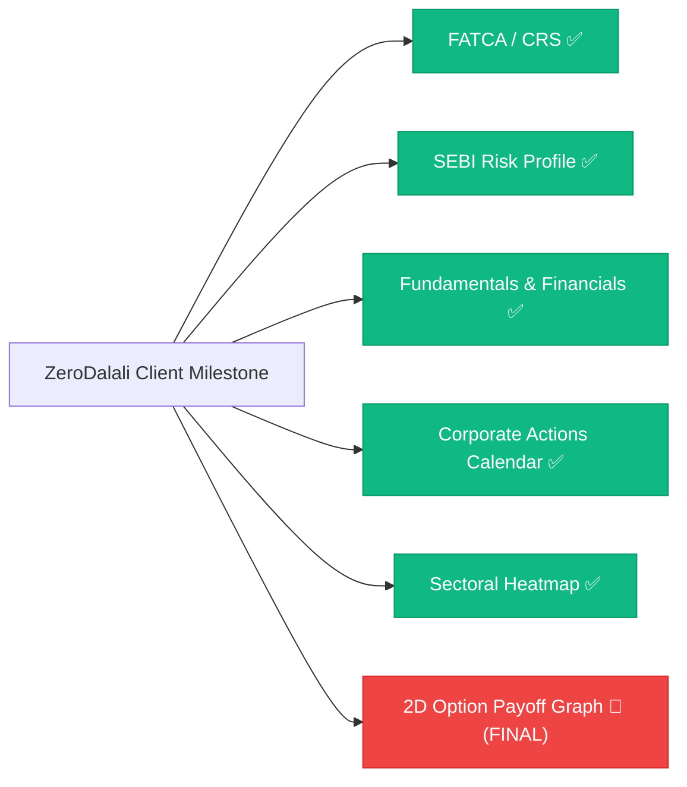

# ZeroDalali: Unimplemented & Simulated Features Inventory

This document tracks all features, screens, flows, and integrations from the production-grade trading app checklist that are **either completed**, **in progress**, **unimplemented**, or **operating as client-side simulations/mocks**.

---

## 📊 Executive Summary & Progress Dashboard

| Category | Total Tracked | Completed | In Progress | Pending | Completion % |
| :--- | :---: | :---: | :---: | :---: | :---: |
| **Client-Side Advanced Features** | 6 | 5 | 0 | 1 | **83.3% Done** |
| **Simulated / Mock Backend APIs** | 7 | 0 (Simulated) | 0 | 7 (Need Keys) | **Mocked / Ready for SDK** |
| **Total Test Suite Health** | 228 tests | 228 passed | 0 failing | 0 skipped | **100% Passing** |

```
[████████████████████████████████████████░░░░░░░░] 83.3% Client-Side Features Completed (5/6)
```

---

## 1. ✅ Completed Features (100% Implemented & Tested)

### 1.1. Compliance & Onboarding
* **FATCA / CRS Self-Declaration & PEP Compliance Module**:
  * **Location**: [profile_screen.dart](file:///d:/Rideal/ZERO/lib/features/profile_settings/presentation/profile_screen.dart) &rarr; Section 2 ("FATCA / CRS & PEP Declaration" tile with live `COMPLIED` badge).
  * **Interactive Sheet**: [fatca_declaration_sheet.dart](file:///d:/Rideal/ZERO/lib/features/profile_settings/presentation/fatca_declaration_sheet.dart):
    * 5-second Indian resident confirmation (Tax Resident: YES, US Person: NO, PEP: Not Applicable).
    * Expandable foreign Tax Identification Number (TIN / SSN) and Country of Tax Residency inputs under CRS mandate.
    * PMLA-compliant Politically Exposed Person (PEP) declaration (Standard Trader, PEP, or Related to PEP).
    * Country of Birth, City of Birth, Occupation, and Gross Annual Income Bracket selectors.
    * Statutory 30-day change notification legal undertaking checkbox and instant confirmation.
  * **Data Layer**: [fatca_declaration.dart](file:///d:/Rideal/ZERO/lib/data/models/fatca_declaration.dart) & [fatca_repository.dart](file:///d:/Rideal/ZERO/lib/data/mock/fatca_repository.dart) with `fatcaDeclarationProvider`.
  * **Automated Tests**: [fatca_test.dart](file:///d:/Rideal/ZERO/test/fatca_test.dart) (7/7 unit and widget tests passing).

* **SEBI Investor Risk-Profile / Suitability Questionnaire**:
  * **Location**: [profile_screen.dart](file:///d:/Rideal/ZERO/lib/features/profile_settings/presentation/profile_screen.dart) &rarr; Section 2 ("Investor Risk Profile" tile with live color-coded category badge: `MODERATE`, `CONSERVATIVE`, `AGGRESSIVE`).
  * **Interactive Sheet**: [risk_profile_sheet.dart](file:///d:/Rideal/ZERO/lib/features/profile_settings/presentation/risk_profile_sheet.dart):
    * **Overview View**: Real-time category hero card (Score out of 25), Risk Tolerance Meter gauge, SEBI F&O Derivatives suitability advisory, recommended asset class chips, and "Retake Questionnaire" trigger.
    * **5-Step Stepper Quiz**: Statutory questions (Age Bracket, Investment Objective, Market Experience, 20% Drawdown Reaction, Savings Allocation %); animated progress bar and option cards.
  * **Data Layer**: [investor_risk_profile.dart](file:///d:/Rideal/ZERO/lib/data/models/investor_risk_profile.dart) & [risk_profile_repository.dart](file:///d:/Rideal/ZERO/lib/data/mock/risk_profile_repository.dart) with `riskProfileProvider`.
  * **Automated Tests**: [risk_profile_test.dart](file:///d:/Rideal/ZERO/test/risk_profile_test.dart) (10/10 unit and widget tests passing).

### 1.2. Stock Research & Discovery
* **Sectoral Heatmap & Market Treemap Visualizer**:
  * **Location**: [sector_heatmap_screen.dart](file:///d:/Rideal/ZERO/lib/features/heatmap/presentation/sector_heatmap_screen.dart) (Route `/heatmap`, `ZeroDrawer` &rarr; "Market Heatmap", and `QuotesScreen` AppBar top action).
  * **Interactive Features**:
    * **Dual View Modes**: Switch seamlessly between **Treemap View** (proportional tiles colored by % change) and **Sector Grid View** (card-by-card advance/decline split and top movers).
    * **Dynamic Heatmap Color Gradient**: Deep Emerald Green (`>= +2.5%`) to Deep Crimson Red (`<= -2.5%`).
    * **Live Market Breadth Banner**: Real-time Advance / Decline count (`🟢 30 Adv` | `🔴 10 Dec`) and top-performing sector pill.
    * **Timeframe Filters**: `1D (Today)`, `1W (1 Week)`, `1M (1 Month)`, `1Y (1 Year)`.
    * **Scope Filters**: `All Sectors`, `Nifty 50`, `Top Gainers`, `Top Losers`, with active sector drilldown.
    * **Stock Quick Action Modal** ([stock_quick_action_sheet.dart](file:///d:/Rideal/ZERO/lib/features/heatmap/presentation/widgets/stock_quick_action_sheet.dart)): Tap any stock tile to inspect CMP, Day High/Low slider, Market Cap, Sector Weight, and trigger 1-tap **BUY**, **SELL**, **Chart**, **Details**, or **Options**.
  * **Data Layer**: [sector_heatmap.dart](file:///d:/Rideal/ZERO/lib/data/models/sector_heatmap.dart) & [sector_heatmap_repository.dart](file:///d:/Rideal/ZERO/lib/data/mock/sector_heatmap_repository.dart) with `sectorHeatmapDataProvider`.
  * **Automated Tests**: [sector_heatmap_test.dart](file:///d:/Rideal/ZERO/test/sector_heatmap_test.dart) (10/10 unit and widget tests passing).

* **Market-Wide Corporate Actions Master Calendar**:
  * **Location**: [economic_calendar_screen.dart](file:///d:/Rideal/ZERO/lib/features/calendar/presentation/economic_calendar_screen.dart) &rarr; Segmented Tab `[ Corporate Actions ]`.
  * **Interactive View**: [corporate_actions_view.dart](file:///d:/Rideal/ZERO/lib/features/calendar/presentation/widgets/corporate_actions_view.dart):
    * Instant category filter chips with live badge counters: `All (12)`, `Dividends (6)`, `Splits (2)`, `Bonus (1)`, `Buybacks (2)`, `Rights (1)`.
    * Instant search bar filtering across stock ticker, company name, and action type.
    * Expandable corporate action cards displaying CMP, Ex-Date countdown ("In 3 days", "Tomorrow", "Passed"), action value (yield %, split ratio, bonus ratio, buyback price & premium).
    * SEBI compliance & eligibility rules info banner on card expansion (T+1 demat settlement rule for record date qualification).
  * **Data Layer**: [corporate_action.dart](file:///d:/Rideal/ZERO/lib/data/models/corporate_action.dart) & [corporate_actions_repository.dart](file:///d:/Rideal/ZERO/lib/data/mock/corporate_actions_repository.dart) with `filteredCorporateActionsProvider`.
  * **Automated Tests**: [corporate_actions_test.dart](file:///d:/Rideal/ZERO/test/corporate_actions_test.dart) (8/8 unit and widget tests passing).

* **Company Fundamentals, Financial Statements & Shareholding Pattern**:
  * **Location**: [quote_detail_screen.dart](file:///d:/Rideal/ZERO/lib/features/quote_detail/presentation/quote_detail_screen.dart).
  * **Widgets**:
    * [fundamentals_tab.dart](file:///d:/Rideal/ZERO/lib/features/quote_detail/presentation/widgets/fundamentals_tab.dart): 10-metric Valuation Ratios Grid (P/E TTM, Sector P/E, P/B, Debt/Equity, ROE, ROCE, Dividend Yield, Market Cap, Beta, EV/EBITDA, Book Value), Sector discount/premium comparison banner, and Company Profile.
    * [financials_tab.dart](file:///d:/Rideal/ZERO/lib/features/quote_detail/presentation/widgets/financials_tab.dart): Interactive `[ Quarterly ]` vs `[ Annual ]` switch, Income Statement cards (Revenue, Operating EBITDA, Net Profit, EPS with YoY growth %), Balance Sheet snapshot, and Cash Flow statement.
    * [shareholding_tab.dart](file:///d:/Rideal/ZERO/lib/features/quote_detail/presentation/widgets/shareholding_tab.dart): Segmented horizontal progress bar (Promoters `#4F46E5`, FII `#06B6D4`, DII `#10B981`, Public `#F59E0B`), institutional QoQ trend indicators, and SEBI 25% Minimum Public Shareholding compliance notes.
  * **Data Layer**: [stock_fundamentals.dart](file:///d:/Rideal/ZERO/lib/data/models/stock_fundamentals.dart) & [stock_fundamentals_repository.dart](file:///d:/Rideal/ZERO/lib/data/mock/stock_fundamentals_repository.dart) (Curated data for RELIANCE, TCS, INFY, HDFCBANK, TATAMOTORS + procedural fallback for all equities).
  * **Automated Tests**: [fundamentals_test.dart](file:///d:/Rideal/ZERO/test/fundamentals_test.dart) (unit and widget tests passing).

---

## 2. ❌ The Final Remaining Client-Side Feature (Only 1 Item Left)

### 2.1. Interactive 2D Option Strategy Payoff Graph
* **Status**: 🔴 **Unimplemented / Final Client Item**
* **Category**: Advanced Derivatives (F&O)
* **Description**: Graphical visualizer for multi-leg option combinations (Spreads, Straddles, Strangles, Iron Condors).
* **Missing Components**:
  * Interactive 2D Cartesian chart plotting Profit/Loss on the Y-axis against underlying spot price on the X-axis at expiry.
  * Live calculated metrics: Max Profit (₹ or Unlimited), Max Loss (₹ or Unlimited), Breakeven Points (Lower & Upper), and Risk:Reward Ratio.
  * Visual markers: Current Underlying Spot Price vertical dashed line, Breakeven zero-crossover points, and Green/Red profit/loss zones.
  * Integration into [baskets_screen.dart](file:///d:/Rideal/ZERO/lib/features/baskets/presentation/baskets_screen.dart) and [option_chain_screen.dart](file:///d:/Rideal/ZERO/lib/features/option_chain/presentation/option_chain_screen.dart).

---

## 3. ⚠️ Simulated / Mock-Only Features (Pending Live External APIs & Keys)

These features have complete UI workflows, animations, and state machines, but operate in client-side simulation until live third-party enterprise credentials are provided:

| # | Feature / Workflow | In-App Screen / Widget | Current Behavior in App | What is Required for Live Production |
| :-: | :--- | :--- | :--- | :--- |
| **1** | **DigiLocker / UIDAI Instant Aadhaar eKYC** | [kyc_management_sheet.dart](file:///d:/Rideal/ZERO/lib/features/profile_settings/presentation/kyc_management_sheet.dart) | Simulates file upload of Aadhaar/PAN image with mock OCR and progress bar. | Integration with an authorized KRA (CVL/NDML/Karvy) or DigiLocker OAuth2 API for instant XML verification. |
| **2** | **Penny-Drop Bank Verification** | [funds_screen.dart](file:///d:/Rideal/ZERO/lib/features/funds/presentation/funds_screen.dart) | Displays simulated verified bank account with IFSC and penny-drop checkmark. | Integration with an IMPS Penny-Drop API (e.g., RazorpayX, Cashfree, Decentro) to verify account holder name match with PAN. |
| **3** | **Real Broker / Exchange OMS API** | [order_simulation_engine.dart](file:///d:/Rideal/ZERO/lib/data/mock/order_simulation_engine.dart) | All orders, executions, SL-M triggers, and positions execute in high-fidelity local engine. | Connecting to an active SEBI-registered broker API (e.g., Zerodha Kite Connect, Angel One SmartAPI, Finvasia Shoonya, or NSE NOW). |
| **4** | **Payment Gateway Webhooks** | [payment_gateway_dialog.dart](file:///d:/Rideal/ZERO/lib/features/funds/presentation/payment_gateway_dialog.dart) | Simulated UPI (GPay, PhonePe, Paytm) and NetBanking modal with instant mock credit. | Live PG SDK integration (Razorpay, Cashfree, BillDesk, or PayU) with backend server webhook validation. |
| **5** | **Live SMS & WhatsApp Alerts** | [notification_preferences_sheet.dart](file:///d:/Rideal/ZERO/lib/features/notifications/presentation/notification_preferences_sheet.dart) | Preferences configured in-app; alerts delivered to in-app notification center. | Integration with an enterprise SMS/WhatsApp gateway (Twilio, MSG91, Gupshup, or Karix). |
| **6** | **CDSL Demat Margin Pledge** | [funds_screen.dart](file:///d:/Rideal/ZERO/lib/features/funds/presentation/funds_screen.dart) | Margin collateral numbers are calculated and credited in Funds with simulated haircut. | Integration with CDSL's webview redirect flow for OTP-based e-DIS pledge authorization. |
| **7** | **IPO Real Allotment Sync** | [ipo_list_screen.dart](file:///d:/Rideal/ZERO/lib/features/ipo/presentation/ipo_list_screen.dart) | Bids placed and stored in Bids tab with simulated mandate acceptance. | Registrar API integration (Link Intime, KFintech) for real-time allotment and UPI mandate status. |

---

## 4. Final Client-Side Milestone Roadmap



1. **Step 1 (Final Client Feature)**: Implement Interactive 2D Option Strategy Payoff Graph in Baskets and Option Chain to achieve **100% Client-Side Completion**.
2. **Step 2 (Production Deployment)**: Connect live enterprise API credentials for Payment Gateway, Broker OMS, and SMS.
